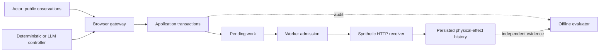

# Architecture

The current benchmark uses two distinct business environments, FlowBoard and OpsConsole, under `afterclick/completion_v12/benchmark/`. FlowBoard reuses `afterclick.api.create_app`, the shared versioned domain model and PostgreSQL migrations; OpsConsole provides its own business tables and mutation semantics. The two HTML interfaces are runtime assets, not documentation screenshots.

A PostgreSQL advisory transaction lock serializes writes within each isolated `ac_*` experimental schema. Admission and containment already share that lock. The legacy receiver nevertheless honors tickets admitted before protection; serialization does not recall those tickets. Protection before admission can block an effect, while a later successful containment acknowledgment does not establish revocation of admitted work.

The worker advances independently of actor inference. Browser commands, actual transaction return bounds, worker admission audits, and physical receipts are separate records. The original data do not reveal precise historical commit or authority-read instants. Current mechanism probes wrap the unmodified transaction/worker/receiver paths and engineer order using barriers; they are neither new agent trajectories nor measurements of individual prevention deadlines.

The evaluator receives private contracts, snapshots, event logs and receiver evidence. Models receive only public observations and do not receive oracle labels, hidden scheduler state, or recoverability certificates. Restoration uses supported public controls; snapshot replacement is never a live recovery primitive.

The browser runtime, transport, runner, qualification and outcome oracle are in `afterclick/completion_v12/benchmark/`; `oracle_v2.py` and `research_ops/scripts/v12_independent_audit.py` provide separately implemented scoring. Current raw readers are in `research_ops/publication/analysis/`. `paper/figures.py` is the single principal plotting pipeline and `paper/tables.py` generates numerical tables from checked evidence. `evidence/index.json` is the reader-facing evidence index.

Exact frozen reproduction runs in the restored historical checkout, where all original 180 source/gate checks remain unchanged. The old replay implementation and other superseded research systems are indexed by `archive/SNAPSHOTS.json`. Only its small shared HTTP server remains active because browser protocol tests depend on it.
