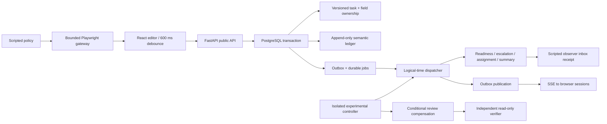

# Architecture

## Implemented path

SSE delivers observations. It does not cause business writes. Browser acknowledgement only records
transport receipt; it is not a causal label or proof of a human observing content.

## Service contracts

`afterclick.api:create_app` serves projects, tasks, PATCH, comments, activity, notifications,
`GET /api/events`, and event acknowledgements. PATCH requires an expected version, unique operation
ID, and a nonempty validated changes object. Field ownership is withheld from public task responses.

Each operation ID stores a hash of the exact request and the original committed response. Identical
retries return that response; ID reuse with different content conflicts. A stale version returns 409.
The React editor rebases nonoverlapping fields after comparing them to its original base. Overlapping
edits preserve the unsaved draft and require explicit resolution. Unknown response outcomes retain
the original operation for retry. The UI blocks further writes during an unresolved save.

The `X-Action-ID` and `X-Actor` headers are research provenance, **not authentication**. The controlled
testbed trusts its harness. The gateway injects stable IDs into existing browser requests; it cannot
write directly to the backend. It permits navigate/fill/click/select/read/wait only. Consequential
actions require the previous autosave to settle, preventing two actions being silently attributed
to one debounced PATCH. This is a bounded scripted adapter, not yet a full BrowserGym or LLM policy.

`afterclick.control:create_control` is a separate FastAPI app requiring a bearer token and an
`ac_*` experimental schema. It provides reset, scheduler advance/release/pause, state, effects, and
pending-job inspection. It is not started by Compose, exposed through nginx, or included in browser
observations. If used manually, bind it to loopback; keep its token outside browser state.

## Transactions and scheduling

One PostgreSQL advisory transaction lock per schema serializes writes, scheduling, and compensation.
This deliberately small design models stale clients and event interleavings without pretending to
provide distributed-worker concurrency. All task updates also include a version predicate. Task
ownership maps fields to the last writer action, detecting overlapping and same-value/ABA edits.

Task mutation, semantic ledger row, outbox record, and workflow job are committed atomically.
The queue is durable. Job effects and its `done` status commit in one transaction; a crash rolls
back both. Job IDs are unique. The scheduler rejects backwards time, respects parent completion,
and selects work by `(due_time, SHA256(seed, job_id))`. Publications are additionally ordered by
outbox ID so reconnect cursors cannot skip late-published lower IDs. Failed advancement rolls back
the entire advancement; it is not evidence that the modeled event happened.

Normal use enables a 100 ms wall-clock tick. Experiments disable that tick and explicitly advance
logical time. Client debounce uses a separate Playwright clock installed before navigation. No
claim is made to control all possible browser timers, operating-system scheduling, or network faults.

## Workflows

| Trigger | Job behavior | Effects / idempotency |
|---|---|---|
| Reviewed or status changed | Read current prerequisites; a reviewed or Done prerequisite is satisfied | Versioned dependent `ready`; notice only on transition to ready |
| Priority request sets Critical | Process the committed trigger | Owned escalation and notification |
| Assignee changed | Process the committed trigger | Notification with enqueued assignment value |
| Status changed | Count current Done tasks | Versioned project completion summary only when changed |

Every PATCH queues a workflow job; a description-only job is a deliberate no-op. Review and status
workflows read state at execution time, whereas assignment/escalation notices reflect queued
triggers. These semantics are fixed, documented application behavior rather than mutated search code.

The initial fixture has one prerequisite edge. Notification delivery places a receipt in the durable
inbox of `release-observer`, a scripted actor. The task contract treats receipt as irreversible. This
is not external email, human cognition, or real-world notification delivery.

## Storage and immutable history

Alembic revisions define projects, tasks, dependencies, comments, operations, outbox, jobs,
notifications, deliveries, escalations, semantic effects, runtime state, and SSE receipts. Activity
is a projection of semantic effects rather than a duplicated table. Task, project, notification,
escalation, and comment business records have versions. Historical effect/delivery rows reject
UPDATE/DELETE with database triggers. The isolated fixture-reset path explicitly enables deletion;
it is not a recovery primitive. No claim is made against a malicious database administrator.

Experiment schemas isolate all branches. Each fresh branch starts from migrations plus a fixed
fixture. Snapshot reads use repeatable-read isolation. Replay hashes retain versions, field owners,
operations, pending jobs, ledger, outbox publication, and logical clock. Random SSE session receipts
are retained in raw artifacts but explicitly excluded from equivalence. Research reports and
certificates currently live in JSON files instead of dedicated research tables.

## Replay validity and recovery

The demo reconstructs the committed-description checkpoint independently in seven worlds. It
compares DB, browser-storage, observation, prefix-history, pending-write, and pending-job evidence.
Execute and suppress each have an identical-continuation placebo. Mismatches make the result invalid;
failed records remain in the run directory. This reconstructs a **quiescent deterministic prefix**,
not arbitrary in-flight JavaScript state. A browser storage export alone is never called a snapshot.

Recovery supports one owned review mutation and its owned readiness effects. It validates all
ownership/value predicates before any compensation, cancels pending owned jobs, removes undelivered
owned notifications, and conditionally restores only affected fields. Delivered receipts and their
notifications remain. Audit rows are retained. The planner reports attempted operations, never a
ground-truth recovery class.

The separate oracle compares actual before/after states with a suppressed reference and preservation
requirements. It checks goal success, retained history, unaffected fields/tables, residual jobs,
notifications, and ownership conflicts. Receipt evidence proves impossibility only under this
fixture's modeled interfaces. Unknown workflows or unsettled writes yield UNKNOWN; an incomplete
horizon yields CENSORED. A legitimate overlapping write yields CONFLICT. Unsupported planners are
not called mathematically irreversible.

## Deferred boundaries

No learned shield, staging enforcement, LLM replanning, CP-SAT planner, distributed tracing export,
general causal graph, arbitrary application recovery, or production identity system exists yet.
These are explicit future milestones, not empty interfaces presented as implemented systems.
