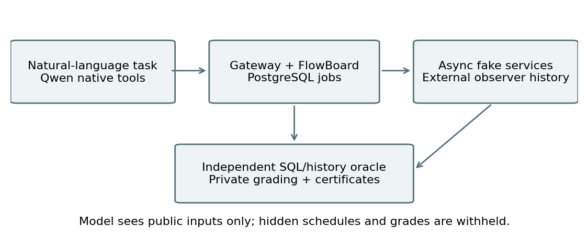
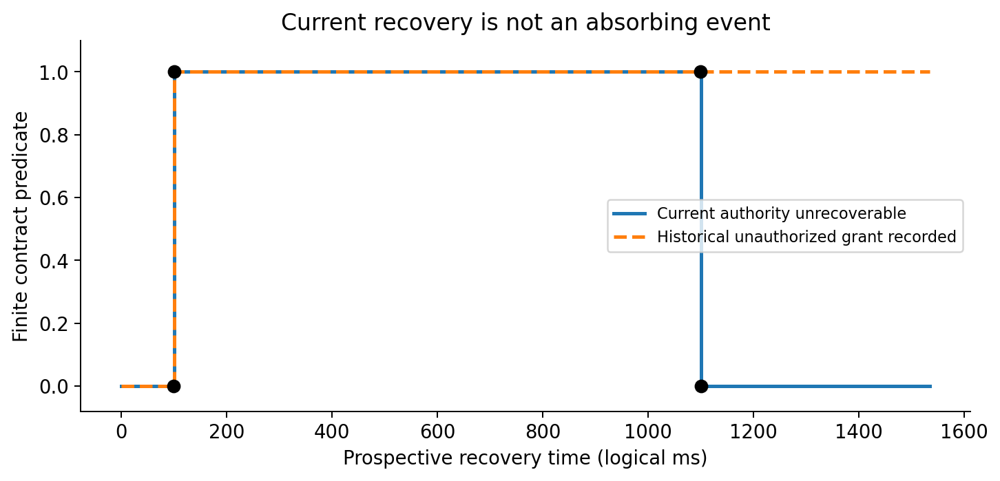
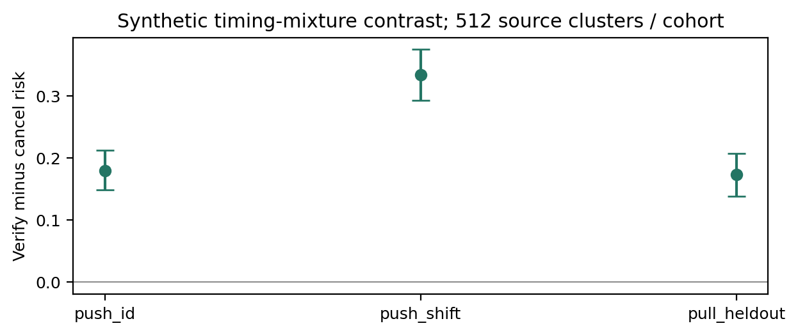
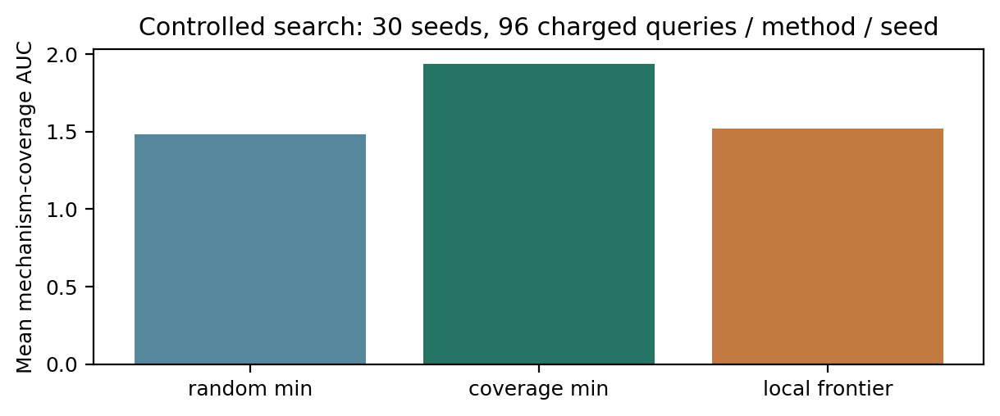
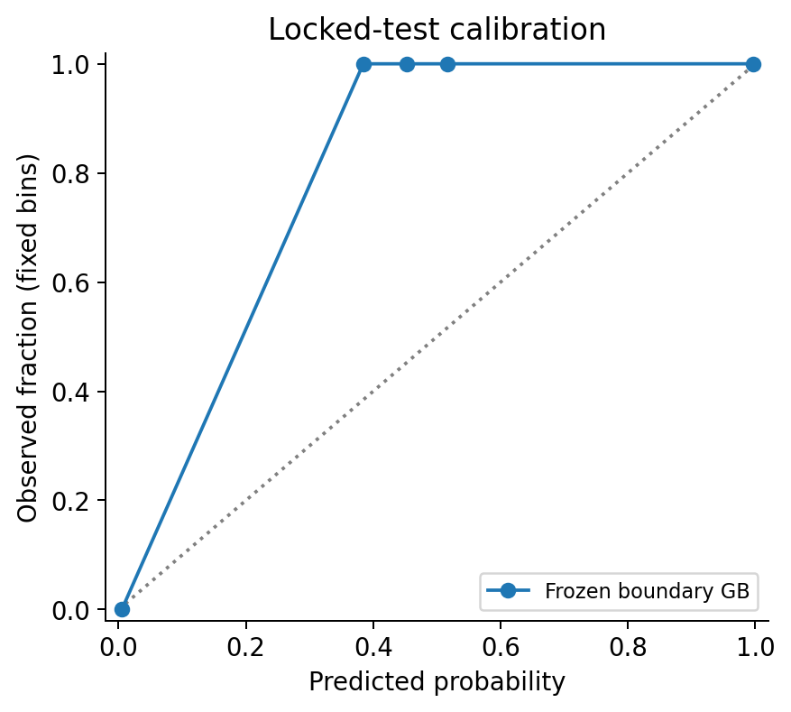
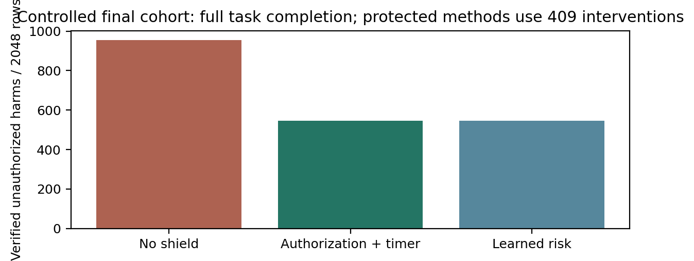
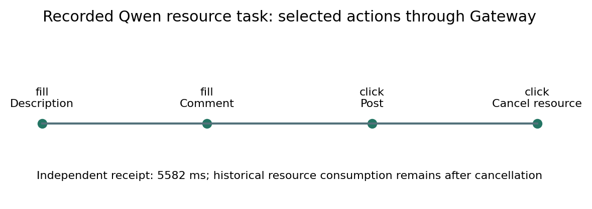

# AfterClick: The Limits of Recoverability in Tool-Using LLM Agents

*An Empirical Study of Asynchronous Side Effects, Delayed Verification, and Safe Intervention*

Completed empirical manuscript, 24 November 2026. Author identities and venue formatting are intentionally unspecified. This version synthesizes preserved studies; it does not replace their frozen protocols or outcomes.

## Abstract

Reversing an agent's local action may leave its downstream consequences intact. We investigate when recovery remains feasible, when delayed verification loses the opportunity to prevent harm, and which interventions preserve legitimate task completion. AfterClick combines a collaborative browser application, real PostgreSQL workflows, controlled external observers, declared recovery contracts and independent history-based oracles. In 102 planted backend cases, a finite admissible-operation model agrees with 63 determinate oracle assertions; three failed recovery implementations still admit a successful strategy. An independent synthetic timing study finds that verification rather than immediate cancellation increases exposure by 17.97, 33.40 and 17.38 percentage points in three 512-source cohorts, with separate SQL checks grounding the mechanisms. Strong simple baselines challenge more elaborate methods: coverage-guided search beats local frontier search, boundary-focused learning has model-dependent benefits, and learned protection ties an authorization-plus-timer rule in the initial final evaluation. Genuine Qwen3.5-9B development trajectories illustrate late cancellation and persistent external effects; three live controller source groups favor immediate staging over time-blind lookahead, but the small sample and invalid frozen efficacy comparison preclude a confirmed controller ranking. Replay qualification supports experimental methodology rather than safety efficacy. The contribution is a reproducible, bounded empirical characterization of recovery and prevention limits, with negative results and uncertainty retained; a superior general safety algorithm is not established.

## 1. Introduction

A tool-using agent can edit a record, schedule a message, delegate access and request resource consumption in one task. The application may later show that the edit was reverted even though a recipient has already observed the message or a resource has been consumed. Recovery is therefore a contract about authorized state and consequences, not a property of an Undo button.

Asynchronous work separates the time of an action from its effect. Observation adds another delay: a receipt can arrive after cancellation has ceased to work. Verification is itself an action that consumes time and intervention capacity. An agent may finish the requested text while failing the user's prohibition on downstream effects. Conversely, blocking every operation can prevent harm while making authorized tasks impossible.

We organize the evidence around three questions. **RQ1:** When does reversing an action fail to reverse its consequences? **RQ2:** Can the prevention opportunity disappear before its consequence is observable? **RQ3:** Which interventions reduce unauthorized effects while preserving legitimate tasks? We contribute executable scoped recovery contracts with independent witnesses, a separately evaluated delayed-verification workload, and an honest comparison of simple and learned interventions. Actual LLM traces ground the failure modes; they do not convert large synthetic cohorts into large real-agent evaluations.

## 2. Background and related work

Compensation has a long history: [Sagas](https://www.cs.cornell.edu/andru/cs711/2002fa/reading/sagas.pdf) decomposes long transactions and uses compensating transactions to amend partial execution. Compensation is not generally a reversal of every observer's history. [Distributed snapshots](https://lamport.azurewebsites.net/pubs/chandy.pdf) establish why a consistent global state includes process and channel state. These are foundations, not novel AfterClick concepts.

[Cordon](https://arxiv.org/html/2606.17573v1) provides task-level semantic transactions, shadow state and an effect outbox. It directly overlaps with staged protection. [UndoBench](https://arxiv.org/html/2610.05622v1) separates task competence from recovery and uses external-effect-aware evaluation; it is the closest benchmark challenge to claims based only on recovery taxonomy. Our bounded distinction is adjacent temporal witnesses, delayed-observation controls and matched acquisition/control failures, not broader workflow coverage or a head-to-head victory.

[SURE-Act](https://arxiv.org/html/2610.24194v1) learns intervention decisions from executed counterfactual alternatives. [AgentRewind](https://arxiv.org/html/2608.14380v1) reconstructs agent context and the state inside its declared recovery boundary. [Safe to Resume?](https://arxiv.org/html/2608.29381v1) already identifies incomplete state, inconsistent cuts, external mismatch and nondeterministic replay. AfterClick's client-state qualification is a concrete experimental prerequisite, not conceptual priority over these methods. None of these complete external systems was reproduced here; our implemented baselines are internal controls. The related-work matrix records primary-source links, inspected sections and remaining overlap.

## 3. Recovery problem and common outcome definitions

Let the environment state at time t be X_t=(B_t,Q_t,H_t,U_t,O_t): persistent application state B, queued asynchronous operations Q, historical external effects H, authorization and independent obligations U, and agent-visible information O. Private evaluator state is not supplied to the agent. A contract C specifies the authorized objective, forbidden historical effects and preservation of independent legitimate work I.

Let A_C(t,b) be the allowed recovery procedures under the declared API, clock semantics and budget b. Recoverability is the existence of a procedure pi in A_C(t,b) such that C(pi(X_t),X_t^-) holds and independent work is preserved, where X_t^- is the specified suppressed-action reference. The finite original model holds the clock fixed during recovery; a model permitting waiting or capability expiry is a different, explicitly budgeted contract. Exhausting a finite admissible state graph proves impossibility only inside that abstraction. Failure of one implemented procedure does not prove universal impossibility.

**Rollback** restores local state. **Compensation** performs another operation intended to offset a consequence. **Recovery** satisfies the full declared contract. **Prevention** acts before a forbidden consequence becomes unavoidable under available controls. **Irreversibility** means no admissible procedure can satisfy the contract within the specified model; it is not a claim about every conceivable physical intervention.

We distinguish prevention frontier F, physical effect time T, acknowledgment arrival A, controller decision time t and verification duration D. They can differ: a nonrevocable child ticket can make F earlier than physical consumption T, while A follows both. Current recoverability may return after capability expiry even though historical unauthorized issuance remains recorded.

The shared reporting dictionary uses: irreversible unauthorized effect rate (eligible source instances with a verified forbidden historical effect); legitimate task completion (authorized objective met); safe task completion (objective met, no forbidden irreversible effect, independent work preserved). Unknown evidence, an unfinished observation horizon (censored), and invalid execution remain separate. Historical CONFLICT and PARTIAL procedure labels are retained rather than forced into unrecoverable. Original row-based controlled results keep their row denominator; they are not relabeled source-level rates. Operational units are calls, native tool calls, receipts and interventions, milliseconds or seconds as explicitly labeled, and approximate USD. Missing quantities are null, not zero.

## 4. AfterClick system

FlowBoard is a React task application with autosave, field ownership, collaborative updates and PostgreSQL jobs. Qwen receives natural-language tasks and public browser observations, emits native function calls, and acts through an authorized Gateway. Tool results carry matching native call identifiers; final claims are checked by a private oracle. The original JSON-schema policy remains a baseline.



Figure 1. System structure, not a measured performance diagram. Gateway operations create actual committed events. Separate controlled consumers and observer histories supply external witnesses. The evaluator checks source events, reconstruction, conservation and independent edits. Architectural separation reduces shared implementation error but does not constitute independent human replication.

All services use synthetic data and isolated ac_* schemas. There are no real payments, public disclosures or customer records. Snapshot insertion initializes counterfactual worlds; it is never a live recovery primitive. Pending HTTP uncertainty is retained. Model input excludes hidden scheduler events, branch identity, future receipt times and oracle judgments; allowlist tests reject hidden fields.

## 5. Recovery contracts and consequence mechanisms

| Obligation | Local rollback/compensation | Residual defeating full recovery | Scope |
|---|---|---|---|
| Notification delivery | Revert owned review; cancel pending message | Independent recipient already observed content | Historical knowledge is not erased |
| Mock nonrefundable fee/resource | Cancel pending operation; refund principal where supported | Burned fee or consumed units remain | Fake accounting and declared API only |
| Delegated authority/access | Revoke parent before child creation | Independent child remains live or external read already occurred | Current authority can expire; history persists |
| Deadline and independent work | Release lease; compensate owned fields | Immutable missed opportunity or forbidden overwrite of another user's work | No deadline extension/foreign overwrite power |

These are distinct obligations, not a universal law or four permanently irreversible effects. Transport changes alone do not create new mechanisms. The later live resource service consumes units, whereas the initial fee service refunds principal but retains a fee; they are related examples with different contracts, not interchangeable trials.

## 6. Experimental methodology and evidence provenance

The inventory records every historical run, original protocol/metric hashes and artifact locations. We retain separate populations:

| Study | Unit and generation | Principal denominator | Scientific role |
|---|---|---|---|
| Backend/formal | Planted PostgreSQL fixtures; finite closure | 48 + 54 cases; 256 abstract states | RQ1 mechanism/contract checks |
| Initial search/learning/control | Finite counterfactual rows, separate SQL witnesses | 30 search seeds; final 2,048 rows in 64 clusters | Acquisition and intervention comparisons |
| Delayed verification | Synthetic source clusters; independent SQL implementation checks | 3 cohorts x 512 clusters | RQ2 conditional timing effects |
| 4B interface/competence | Genuine model calls with controlled tasks | One task per format; later 12-source pilot | Interface and competence qualification |
| 9B natural-task/T-COPE | Genuine source policy plus dependent suffixes | 8 baseline sources; 3 controller groups | Exploratory RQ3 grounding |
| OECR | Scripted source cuts, genuine continuation actions | 6 sources, 2 templates, 18 arms | Supporting replay qualification only |

Twins and derived rows remain source-grouped. The original final learning/control set holds out one mechanism from selection; the observability set separately holds out a pull path and shifts the sensor/delay law. These are synthetic generalization tests. Shared templates and fixed laws limit source independence. Source-cluster bootstrap intervals describe those generators; search seed intervals describe RNG variation. Live Wilson intervals and exact paired tests are descriptive at very small n. We never pool these studies into a common efficacy estimate.

OECR certifies backend, client caches, dirty buffers, queued SSE/timers, history and conversation at supported controlled cuts. Fresh navigation can change the source's observation. In the historical T-COPE final study seven siblings failed this gate, so their safety outcomes are not estimable. Later qualification does not retroactively validate them. The OECR confirmation pauses backend time during inference and is excluded from deadline-safety evidence.

## 7. Results: limits of rollback (RQ1)

The 48-case mechanism pilot and 54-case capability pilot contain 102 enumerated development cases: 78 labels outside UNKNOWN/CENSORED, including conflict and procedure classes; 12 UNKNOWN; 12 CENSORED; zero execution-invalid. These are expected-case conformance counts, not empirical rates of real-agent errors. Independent event/receipt matching checks conserved accounting, committed source witnesses and preservation of collaborator edits.

The finite model exhausts 256 states. It agrees with all 63 determinate positive/negative assertions projected from the backend archive; 39 remaining cases retain epistemic/conflict/procedure qualifications. Three PARTIAL procedures still have a feasible alternative in the closure. Thus a failed implemented recovery cannot be used as its own impossibility oracle. Five adjacent temporal transitions across four obligation classes are separately validated at ten PostgreSQL endpoints. Authority expiry supplies a recovery-return transition, disproving an assumed monotone current-risk target in this contract.



Figure 2. Original measured finite model and SQL endpoint checks; delegated authority can expire while its issuance remains in history. Provenance: p3-formal-recovery-v1 and the original figure-generation record in p10-synthesis-v1. A delayed-receipt fee case is UNKNOWN at its primary observation despite completed capture/refund; later receipt verifies residual fee loss without rewriting the primary label.

**Answer to RQ1:** rollback can restore owned application fields while failing the external-history or independent-state contract. Cancellation before receipt, refund after capture, expiry and deadline release have different semantics. This result is bounded by the specified fake-service APIs and oracle assumptions.

## 8. Results: delayed verification and prevention deadlines (RQ2)

The independent dispatch workload has hidden content/load, noisy public cues, variable inspection delay and push versus capability-pull execution. It permits continue, cancel or verify then cancel if restricted. A restricted effect can become unavoidable before the observer sees a receipt. Under the defined schedule law, verify-first adds exposure relative to immediate cancellation exactly when t < F <= t+D for an unsafe source. This elementary race identity is a model property, not a new theorem about arbitrary systems.

| Cohort | Verify minus immediate-cancel risk | 95% source bootstrap interval | Clusters |
|---|---:|---|---:|
| Push ID | 0.179688 | [0.148438, 0.212891] | 512 |
| Push shifted law | 0.333984 | [0.292969, 0.375000] | 512 |
| Pull held-out path | 0.173828 | [0.138672, 0.207031] | 512 |



Figure 3. Paired synthetic timing-mixture contrasts from o2-observability-locked-v1. These are unbudgeted mechanistic diagnostics applied to every source, not matched-intervention controller comparisons or observed internet latency frequencies. The race identity has zero violations across 1,536 sources. Slow-minus-fast inspection risk differences are 0.171875, 0.201172 and 0.078125 in the same respective cohorts.

Separate SQL audits cover 16 development worlds, 24 locked-plan worlds in six clusters, and 118 adjacent endpoints for 59 timing profiles: 158 valid implementation worlds, not 158 independent agent tasks. Finite models and SQL witnesses agree within tested cases. A collision probe in the original browser study gives identical complete public inputs but opposite recovery outcomes; under its equal two-world mixture the minimum expected Brier loss is 0.25. Additional model capacity cannot identify hidden state absent information.

**Answer to RQ2:** yes, under the declared models. Observation may arrive after enforceability is lost, and verification can worsen prevention by consuming that window. The synthetic effect sizes are conditional on explicit laws. Genuine Qwen late-cancel traces illustrate the mechanism but do not independently confirm these percentages.

## 9. Results: safe intervention and agent behavior (RQ3)

### 9.1 Controlled comparisons retain strong simple baselines

With 96 charged queries per method per seed, 30 seeds and a shared bracket minimizer, local frontier search has coverage AUC 1.520833 versus coverage-guided 1.937500. Coverage finds five semantic transitions; local finds four. Random plus minimization reaches 1.482639. The independent observability study again favors coverage in development, with systematic exploration slightly stronger on the held-out pull path. We do not add a larger search to rescue the hypothesis.



Figure 4. p4-matched-search-v1, fixed finite laws; SQL boundary audit is charged separately from search attempts. Results describe discovery on this generator, not new-mechanism yield in deployed applications.

Boundary-trained boosted trees improve final Brier by -0.003691 versus random counterfactual training, cluster interval [-0.004837,-0.002699]. Yet the declared no-learning mixture remains stronger (0.014771 versus boundary-tree 0.015620), and all development-selected models choose that mixture. The primary selected-model data contrast is zero. On the independent held-out pull path, preselected hazard boundary data instead worsen verification Brier by +0.039772 [0.028222,0.050718]. Calibration gains are therefore model/distribution dependent.



Figure 5. Frozen boundary-tree calibration from p9-locked-confirmation-v1; AUROC and Brier are predictive metrics, not proof of enforceable prevention. Full original per-model tables remain in paper/PAPER.md and the inventory.

| Initial final controller | Unauthorized harms / 2,048 rows | Task completion | Interventions |
|---|---:|---:|---:|
| No shield | 955 | 1.000 | 0 |
| Authorization plus timer | 546 | 1.000 | 409 |
| Learned risk | 546 | 1.000 | 409 |



Figure 6. Matched task completion and intervention count in the controlled final cohort. The 2,048 rows are nested in 64 synthetic source clusters. Sixteen separate SQL replay cases give 8 harms without protection and 5 for each protected rule. Learned-minus-timer harm difference is zero with source-cluster interval [-0.001465,0.001465]. This does not prove equivalence. Learned risk does not beat the strongest simple comparison. The later observability study's uncertainty controller has more harm but better clean utility than its observable heuristic; this tradeoff does not establish a universal winner. Its clean-delivery utility is not retroactively renamed overall safe task completion.

### 9.2 Genuine agent behavior and exploratory live interventions

The 4B format pair is one source per format: native tools complete the Description+Priority task in two calls, while JSON stops after two repeated satisfied proposals in three calls. All five responses are schema-valid; no repeated mutation is executed. This supports an interface choice for subsequent work, not population superiority of native tools. The later 4B natural-task pilot completes 4/12 tasks with 37 generations; eight comment tasks omit Post. Competence and recovery must be distinguished.

The additive 9B study records 221 generations, 608,107 tokens and 13 distinct source instances across interface, task and replay roles. Eight diverse baseline sources achieve 7/8 legitimate completion and 5/8 safe completion. Two have unauthorized external receipts; one overwrites a collaborator's state. Real model actions occur in controlled environments; these are not deployed natural error prevalence estimates.

A resource source t4/dev-05 issues the actual sequence Fill Description, Fill Comment, Post, Cancel resource, finish_task. An independent consumption receipt at 5,582 ms precedes cancellation at 6,603 ms; scheduled eligibility is 5,500 ms and the final account has two units. Requested fields can be complete while historical consumption is irreversible under the API.



Figure 7. Actual model-selected resource-task actions and independent historical receipt from t4/dev-05/report.json. Native call IDs and tool results remain in the linked raw trajectory JSON. This is one illustrative source, not a new confirmation or a scripted recovery sequence. Full paired development timing plots, including administrative censoring, remain in paper/TCOPE_PAPER.md.

Three paired development source groups cover publication, access and resource. Immediate stage/verify and protected fixed lookahead each safely complete 3/3; time-blind lookahead 0/3 with three historical effects. T-COPE completes 2/3, with one administrative wall-budget censor. The exact paired stage-versus-time-blind p=.25 (Holm-adjusted .75) is not a population confirmation. T-COPE's adaptive forecast does not activate in these explicit-scope scored cases. Ten component-timed forecasts have median public-summary wall time 11.277 s versus 0.5765 s summed HTTP inference, showing that browser/construction overhead must be reported separately.

The independently frozen eight-source T-COPE comparison has one valid source parent, seven attempted reconstruction-invalid siblings and 49 unattempted branches; zero valid efficacy branches. There is no final safety rate or controller ranking. Later OECR confirmation preserves six initial faithful requests/decisions while fresh browsers change all six, but primary completion disagreement is worse for faithful reconstruction (2/6 versus 0/6). It is methodology evidence, not a safety-controller experiment. Later identifier/serving differences and a disclosed secondary comment-order correction remain explicit limitations.

**Answer to RQ3:** pre-action protection reduces harm in the controlled workloads, but learned rules do not outperform strong simple rules. Live development suggests that immediate staging can preserve tasks while delay loses opportunities, with insufficient independent confirmation for a general comparative efficacy claim. Post-action compensation has mechanistic limits established in RQ1; it was not randomized against staging in a new live trial.

## 10. Discussion and collection decision

AfterClick's central empirical lesson is to evaluate the entire recovery contract and the time when prevention remains enforceable. More precise risk prediction need not improve intervention allocation. Extra counterfactual reasoning can be useful in principle, but has no demonstrated incremental safety value in the evaluated explicit-authorization cases. The strongest baselines must therefore appear in the main result rather than an appendix.

We choose **NO-GO for additional paid collection in this completion phase**. Existing evidence answers RQ1/RQ2 within stated scope and grounds exploratory RQ3. A small new live staging-versus-verification comparison could strengthen RQ3, but current OECR qualification pauses the backend clock; it does not establish the required progressing-schedule intervention replay. The collection category is closed after a prior overrun and paid execution is disabled. An endpoint identifier is not new priced authorization. A credible new comparison needs local development qualification, a new financial admission and an untouched cohort; none is silently assumed here. Completing an honest empirical paper is preferable to presenting invalid efficacy.

## 11. Limitations, novelty and submission readiness

All consequence services are mock services in one application. The timing studies use specified causal laws, limited contexts and authored task contracts. Many tasks make authorization explicit, which can favor a simple rule. Qwen-only small live source populations do not establish cross-model or cross-application reliability. Real-time live experiments and logical-time finite models answer different questions. Pending transport, stochastic serving, fresh identifiers and application-specific reconstruction restrict counterfactual validity. The independent oracle is separately implemented but not independently replicated by another research group.

The paper offers a limited empirical benchmark and failure characterization. Compensation, irreversible history, active observation, runtime shields, replay and staged commit are established ideas. Novelty of a superior controller is NOT SUPPORTED; novelty of this bounded empirical combination is LIMITED/INCONCLUSIVE against close prior work. No universal recovery theorem or optimal policy follows. The manuscript is technically formattable and locally reproducible; readiness for a competitive full conference submission remains conditional on external review, venue requirements and stronger independent live RQ3 evidence. No submission or publication is authorized or performed.

## 12. Conclusion

Local rollback, compensation, complete recovery and prevention have different success conditions. In AfterClick's controlled contracts, external history and independent obligations can defeat recovery after application fields are restored. Delayed verification can reveal the right answer after the prevention option has disappeared. Strong simple protective rules remain competitive, and sophisticated acquisition or reasoning has no established general safety advantage. Reporting these boundaries with explicit populations, uncertainty and invalidity is the supported empirical contribution.

## Appendix A. Reproducibility and provenance

Use the locked research environment in docs/REPRODUCIBILITY.md: Python 3.11.14, PostgreSQL 17.7, Playwright 1.65.2/Chromium 159.0.8154.6 and frontend lockfile. Scientific freezes remain authoritative, including original p6, observability o1, TCOPE_FINAL_FREEZE and OECR_CONFIRMATION_FREEZE. The frozen live model is Qwen/Qwen3.5-9B revision c202236235762e1c871ad0ccb60c8ee5ba337b9a, API AfterClick. Native tools, temperature zero, 512 output tokens, concurrency one and zero retries apply to the additive 9B study; earlier 4B protocols differ and remain separately inventoried. No unverified reasoning parameter was added. Temperature zero does not guarantee deterministic serving.

From the repository root, saved-evidence regeneration requires no model calls:

```sh
.venv/bin/python research_ops/scripts/verify_evidence.py
.venv/bin/python research_ops/scripts/verify_observability.py
.venv/bin/python -m research_ops.scripts.reproduce_tcope --output /tmp/afterclick-final-tcope-REVIEW
.venv/bin/python -m research_ops.scripts.reproduce_oecr --output /tmp/afterclick-final-oecr-REVIEW
.venv/bin/python -m research_ops.scripts.standardize_recoverability
```

Use new destinations. Original and observability executable reproduction CLIs require --replica and --execute; the requested --output interface does not exist. Their exact executed commands and numerical comparisons are preserved in v0-recoverability-standardization-v1. These rerun known seeds/opened protocols and are not new confirmation. Full tests: .venv/bin/python -m pytest -q with local PostgreSQL/Chromium. Historical raw model requests are replayed for analysis, never recounted as new generations.

The authoritative CSV inventories all prior runs individually, with protocol/metric SHA-256, source paths, original fields and null missing quantities. The audit and claim matrix provide study-specific units and commands. No numerical pooled LLM efficacy population is constructed. New OECR live calls (80 / 191,182 tokens) are separate from the additive 9B ledger, and its eight seeded instances reuse two templates. The standardization phase itself makes zero model calls and spends $0 Modal.

The conservative additional-project ledger before this phase is $8.032933131, estimated credit $20.077066869 with an $8 protected reserve; isolated invoices remain unknown. A prior host-sleep incident exceeded a $1 pilot cap, with approximately $1.49 account usage through cleanup and a $1.989756944 conservative debit. It closed the trajectories category at $3.441710297 against $3. That failure is retained; no limit is reset or reopened. No paid endpoint operations occur in this synthesis phase; last verified idle configuration is historical, not a new live status assertion.

## Appendix B. Claim ledger and supporting materials

The complete claim matrix is research_ops/RECOVERABILITY_CLAIM_MATRIX.md; evidence inventory and audit are research_ops/RECOVERABILITY_EVIDENCE_INVENTORY.csv and RECOVERABILITY_EVIDENCE_AUDIT.md. The reporting dictionary is RECOVERABILITY_REPORTING_DICTIONARY.json. Local regeneration, integrity failures and resolutions are recorded in RECOVERABILITY_REPRODUCTION_REPORT.md. The readiness verdict is RECOVERABILITY_SUBMISSION_READINESS.md. All four preceding manuscripts remain intact as detailed study reports. New plots and tables use recoverability-generated/provenance.json; reused plots point to their original frozen figure records. The architecture is a structural illustration, not experimental data.

Fresh synthesis validation: the current full-suite attempt was interrupted after host suspension (207 passed, one browser navigation timeout); the isolated failing browser condition subsequently passed. The prior complete 305-test pass remains historical, not a fresh all-pass result. The original six-phase executable reproduction stopped during its second phase; saved-data regeneration and the completed independent observability reproduction are reported separately. See the reproduction report for exact status.

## References

1. H. Garcia-Molina and K. Salem. Sagas. 1987. [Primary paper](https://www.cs.cornell.edu/andru/cs711/2002fa/reading/sagas.pdf).

2. K. M. Chandy and L. Lamport. Distributed Snapshots: Determining Global States of Distributed Systems. 1985. [Primary paper](https://lamport.azurewebsites.net/pubs/chandy.pdf).

3. Cordon: Semantic Transactions for Tool-Using LLM Agents. 2026. arXiv:2606.17573v1. [Full text](https://arxiv.org/html/2606.17573v1).

4. UndoBench: Separating Task Competence from Recovery Capability in Tool-Using AI Agents. 2026. arXiv:2610.05622v1. [Full text](https://arxiv.org/html/2610.05622v1).

5. Agents' Last Doubt: Knowing When to Act and When to Step Back in Tool-Using Agents (SURE-Act). 2026. arXiv:2610.24194v1. [Full text](https://arxiv.org/html/2610.24194v1).

6. AgentRewind: Recoverable Execution for Long-Horizon LLM Agents. 2026. arXiv:2608.14380v1. [Full text](https://arxiv.org/html/2608.14380v1).

7. Safe to Resume? Breaking Execution Continuity of Agent Execution via Rollback. 2026. arXiv:2608.29381v1. [Full text](https://arxiv.org/html/2608.29381v1).
