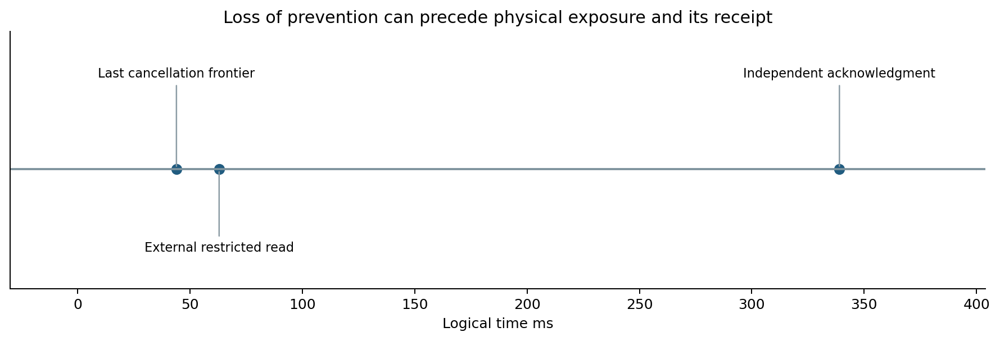
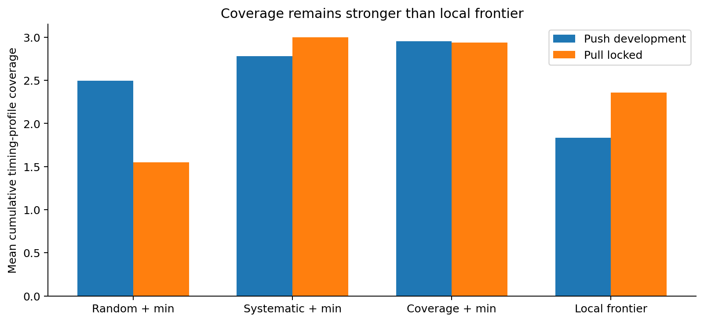
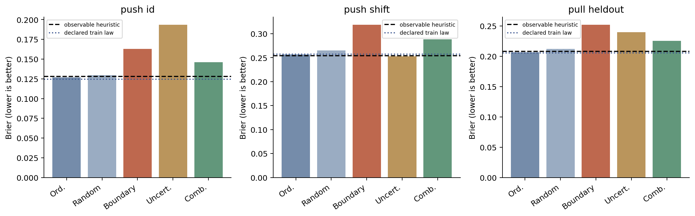
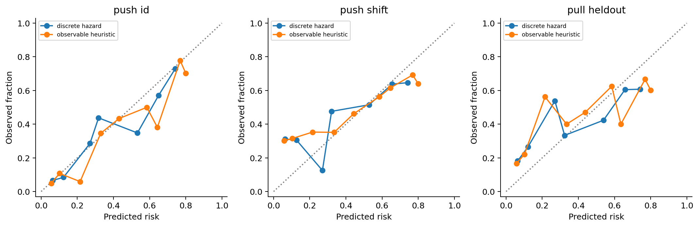
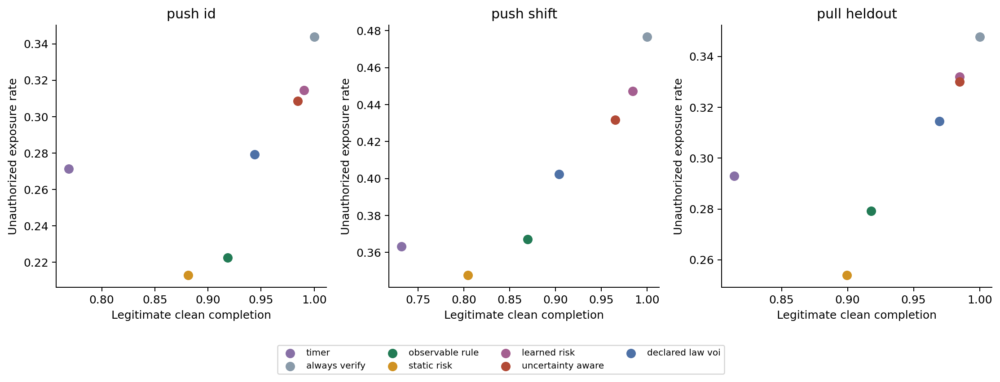
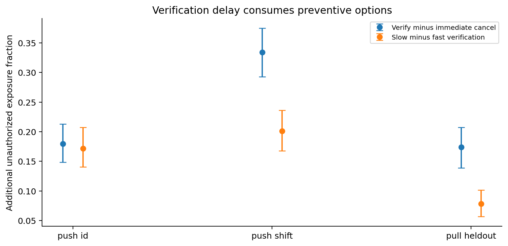

# AfterClick: When Verification Arrives After the Last Chance to Recover

Research paper draft — 23 November 2026. New observability study and preserved original study.
No publication, general deployment guarantee, or new optimal-control algorithm is claimed.

## Abstract

Verification can identify a dangerous action after the environment has lost the ability to prevent
its consequence. We evaluate this problem in AfterClick using two separately recorded studies.
The original fixed-law study found no targeted-search or learned-controller advantage over strong
simple references. A new queued-dispatch workload separates cancellation frontier, external access
and acknowledgment arrival. Its preflight signals are informative but noisy; verification takes
uncertain time while the recipient continues. A held-out capability path can become uncancellable
before the recipient reads the data. Across 1,536 locked synthetic source instances and 118 fresh
PostgreSQL boundary endpoints, we verify a precise race condition: delayed inspection adds harm
relative to immediate cancellation when its reply crosses the prevention frontier. This occurs in
17.4–33.4% of the defined evaluation cohorts. Boundary-focused acquisition worsens held-out Brier
score by 0.0398 for the preselected trained model relative to random counterfactual data. An
uncertainty-aware controller improves on always-verifying in limited matched-utility comparisons,
but does not establish an incremental advantage over the strongest simple/model-based references.
Context-matched development ablations show that acquisition effects depend on both context diversity
and model assumptions. The supported contribution is an auditable temporal-observability benchmark,
a constructive intervention limitation and negative comparative evidence; algorithmic novelty remains
unestablished.

## 1. Motivation and research questions

An asynchronous agent action creates two questions: what has happened, and what can still be
prevented? A missing acknowledgment answers neither. Nor does reversing a source record erase what
an independent receiver has learned. An agent can correctly inspect a payload and still react too
late if an irrevocable capability was issued while the inspection was running.

We ask whether recovery-boundary data and uncertainty-aware intervention improve on strong simple
rules. H1 concerns frontier discovery efficiency. H2 concerns calibrated out-of-distribution risk
prediction under equal label budgets. H4 concerns realized unauthorized effects at comparable task
completion and intervention burden. H5 states that the usefulness of additional observation depends
on whether a prevention frontier is crossed before its arrival. These are hypotheses, not assumed
advantages. No planted action is counted as an organic policy error.

We retain the [original paper](PAPER.md), data, code hashes and locked evaluation unchanged. This
paper distinguishes Study I, its small live-policy grounding, and Study II's independently specified
workload. "Independent" here means new causal specification and a separately written SQL provider
and oracle, not an external team, independently sampled production environment or new live-agent
population.

## 2. Prior work and novelty boundary

[Causal Agent Replay](https://arxiv.org/html/2606.08275v1) already supplies step interventions and
run-forward attribution. [UndoBench](https://arxiv.org/html/2610.05622v1) is a close comparison for
paired fault experiments, boundary-specific recovery and independent effect histories. We do not
claim these ingredients or the lost-ack distinction as new.

[SURE-Act](https://arxiv.org/abs/2610.24194) already learns agent control from counterfactual action
outcomes. [Mnemosyne](https://arxiv.org/abs/2607.00269v3),
[Planarian](https://arxiv.org/abs/2609.35366v1) and
[ACRFence](https://arxiv.org/html/2603.20625v1) overlap with admission, compensation and restore
semantics. A larger architecture diagram would not establish a new contribution.

Jointly valuing information and its consequences is classical
[decision analysis](https://ieeexplore.ieee.org/abstract/document/4082064/authors).
[POMDP planning](https://www.cassandra.org/arc/papers/aij98.pdf) already treats information-gathering
and world-changing actions within a common decision problem. Existing
[probabilistic shields](https://arxiv.org/abs/1807.06096) and
[shielding under partial observability](https://arxiv.org/abs/2204.00755) prevent novelty claims
based simply on using uncertainty to select safer actions. Reading depth and access limitations
are recorded in the literature matrix; abstract-only inspection cannot establish absence of a method.

The candidate delta is a compact, reproducible contract separating loss of prevention from subsequent
exposure and evidence arrival, with independently checked temporal witnesses and acquisition/control
comparisons that retain stronger baselines. The race identity below is elementary under its assumptions,
not a claimed new theorem in decision theory. Benchmark usefulness is supported; publication-level
uniqueness remains **INCONCLUSIVE**.

## 3. Study I: preserved foundations and diagnosis

FlowBoard provides a PostgreSQL scheduler, Chromium Gateway, source ownership/CAS compensation,
and independent effect oracles. The archived study includes 102 planted backend cases over four
recovery obligations, an exhaustive 256-state abstraction, five checked semantic transitions,
14,400 matched search queries, 16,384 finite acquisition queries and a once-only locked final set.
These denominators refer to different evidence units and must not be added as independent trials.

Its local frontier explorer loses to coverage (AUC1.520833 versus 1.937500). The selected final
predictors coincide with a declared no-learning mixture. A fixed tree has a secondary Brier gain
of 0.003691 from boundary data, but remains worse than that reference. Learned and timer shields
tie at 546 harms versus 955 unshielded, with 409 interventions and full task completion.

The likely causes are simple fixed timing laws, a supplied query horizon, explicit synthetic
consent, limited intervention options, few informative features and conditional ambiguity about
hidden mechanisms. Contrary evidence includes the fixed-tree data effect and real SQL witnesses.
The conclusion is not that learning can never help: the first benchmark cannot establish that
incremental help beyond its strongest references.

## 4. Live-policy grounding: interaction format is an empirical choice

A separate bounded development comparison preserves the JSON-schema adapter and adds native
OpenAI-style tools. Tool arguments pass strict validation and use only Gateway operations. Each
returned tool result carries the matching tool_call_id. Mutations settle sequentially; repeated
already-satisfied field proposals are rejected and fed back. Finish requires visible committed goals,
then an independent PostgreSQL task/effect oracle. This shared driver is explicit, not a silent
change to the old baseline.

The same previously failing Description+Priority task is run once per format, JSON first, in fresh
worlds. Native requests send tools and tool_choice:auto without response_format. JSON sends only
its schema format. The existing Dedicated Endpoint is pinned Qwen 3.5-4B at revision
851bf 6e 806efd 8d 0a 36b 00ddf 55e 13ccb 7b 8cd 0a, API model AfterClick. Its generated source shows SGLang 0.5.22
with qwen 3_coder tool parsing and qwen 3 reasoning parsing. The deployed OpenAPI schema declares
reasoning_effort and chat_template_kwargs, but not reasoning. We therefore do not assume the example's
reasoning.enabled mapping; both tested arms retain enable_thinking:false and omit reasoning parameters.

| Format | Task accepted | Generation requests | Tokens | Repeated proposals | Executed repeats |
| --- | --- | --- | --- | --- | --- |
| json_schema | False | 3 | 3302 | 2 | 0 |
| native_tools | True | 2 | 4725 | 0 | 0 |

All five model responses parse, with no uncertain request or generation retry. Native finishes in
two requests; JSON repeats the satisfied Description twice and never sets Priority. No repeated
mutation is executed. Native uses more tokens, but completes the task. Summed generation latency
is 664ms versus 2503ms, excluding shared startup and shutdown. The complete batch takes 203.86s.
Order, representation, prompt and engine grammar are confounded; n=1 per arm cannot estimate
population reliability. Native is provisionally selected in INTERACTION_FORMAT.json, while the
original JSON class and replay interface remain available. No further interface optimization follows.

## 5. Study II: queued dispatch and delayed inspection

The legitimate contract is to deliver an approved public summary or quarantine a restricted one,
while preserving a prepared source edit and an independent note. Restricted content is a synthetic
marker, never personal data. Cancelling clean delivery is a false intervention that harms legitimate
completion. Public task instructions do not reveal which input is restricted.

A noisy preflight alert depends on content class and a noisy congestion hint depends on hidden load.
An advertised reviewer ETA is informative but imperfect. A configured decision delay a is known before
dispatch; the implementation names it age_ms. All initial telemetry is sampled before execution.
Training panels query alternative absolute cancellation times h, while policy evaluation sets h=a.
Thus this is a static-preflight strategy-response model with delayed inspection, not a full online
filter using dynamically refreshed telemetry after an earlier queried time.

Push delivery requires hidden worker service and network flush; its cancellation frontier coincides
with receiver commitment. In the held-out pull path, a parent capability first mints a nonrevocable
child. The recipient dereferences it later. Revoking the parent after minting does not revoke the
child. This changes the causal transition and recovery API, rather than only shifting a numeric delay.
The capability primitive resembles Study I's delegated-authority class; its invention is not a
claimed contribution. The new workload separates its later restricted read, uncertain inspection
and task utility. The held-out path also changes the relationship between load and access timing. A separate shift
cohort reduces alert reliability and increases actual review delay while leaving advertised ETA stale.

The model sees only a, alert, congestion, advertised ETA and prospective h. It sees no source ID,
mechanism, partition, payload, actual delay, event time, receipt, oracle judgment or chosen outcome.
A strict schema rejects hidden fields. Policy choice accepts only that schema; the environment is
invoked after the choice and online quota check. Initial cues have 32 public context cells, plus 201
query horizons: deliberately auditable, but far smaller than natural agent observations.

Three PostgreSQL schemas separate source, receiver and receipt observer. Actual commits implement
source cancellation, child minting, receiver access, independent note edits and receipt deduplication.
The independent oracle reads those histories without importing the simulator. Missing acknowledgments
remain missing; an audit can still inspect the controlled receiver's durable ledger. Review latency
and the perfect-inspection conditional response are simulated contracts, not measured network service
latency. All reported times are logical milliseconds. No SQL snapshot restoration is a recovery action.

## 6. Formal preventability and the verification race

Let U indicate a restricted payload, F the last cancellation frontier, T the later external access,
D inspection latency, and A acknowledgment arrival. Push has F=T; capability pull can have F<T<A.
The permitted controller cannot revoke a child after F or erase receiver history. Under these APIs,
preventing the forbidden read is feasible at time h exactly when U is false or h<F. This is an
**effect-neutralization contract**, narrower than Study I's full task-and-preservation recovery.
Legitimate completion is evaluated separately so safety is not purchased by hiding false interventions.

Let Hc and Hv denote eventual unauthorized access under immediate cancellation at a and perfect
inspection followed by conditional cancellation at a+D. Then

    Hc = 1[U and F <= a]
    Hv = 1[U and F <= a+D]
    Hv - Hc = 1[U and a < F <= a+D].

The expectation is conditional on public information. It quantifies the price of waiting for useful
information, not proof that immediate cancellation always has greater total value. Immediate cancellation
also blocks clean work. A late correct observation cannot restore an unavailable prevention operation.
The identity depends on the stipulated API, correct inspection, tie ordering and eventual access before
the assessment deadline; it is not universal physical impossibility.

Figure 1. One actual SQL witness. Loss of enforceable cancellation precedes physical access and an
independent acknowledgment. Unavailable acknowledgment is recorded separately, never as safety.

## 7. Protocol, acquisition and uncertainty

Original and amended registrations precede acquisition. Development uses push sources only; all
counterfactual siblings remain in one partition. Model selection uses 512 separate development sources.
Pull was inspected in engineering tests, but is absent from model/threshold selection. The once-only
final opening contains 512 fresh source clusters in each of push-ID, shifted-push and held-out-pull
cohorts. Code, protocols, model artifacts and development data are hashed before opening.

Five acquisition arms each receive 256 panels in four campaigns: ordinary, random counterfactual,
boundary, uncertainty-boundary and combined. A panel charges two potential-world evaluations
(cancel and delayed verify), returning three targets: residual unauthorized access for each plan
and clean-task loss from cancellation. Total:5120 panels/10240 potential-world evaluations. Forty
synthetic UNKNOWN and 40 synthetic CENSORED measurement-mask probes are retained;5040 known panels fit
the models. These exercise pipeline handling, not empirical missingness/censoring rates; the hazard
model separately treats unobserved first-event times as right censored at the query horizon.
Here "ordinary" means one randomized plan panel per fresh synthetic source; it still contains
counterfactual labels. It is a generic source-disjoint control, not a measured ordinary-agent
trajectory distribution or an organic LLM rollout.

Training row counts match, but source diversity differs: ordinary has 256 contexts per campaign,
random-CF128, boundary 16, and combined mixes ordinary with boundary contexts. Boundary arms use charged
bracketing queries; uncertainty-context selection uses only the declared public training-law score.
This is a simple acquisition heuristic, not a new active-learning algorithm. Selection can bias both
prevalence and censoring; equal query budgets do not make those distributions interchangeable.

Models are a base rate, pooled temporal hazard/timer, handwritten observable heuristic, declared-law
Bayesian risk, logistic regression,32 shallow boosted trees and a cue-conditioned discrete hazard.
Three response targets are fit without a hyperparameter sweep. The hazard uses observed first loss
of prevention and right censoring; adaptive selection can violate its independent-censoring assumption.
The mean-plus-standard-deviation policy uses four acquisition-fit disagreements as a heuristic,
not a calibrated epistemic confidence guarantee under a changed causal law.

All source clusters are disjoint across training, development selection and final evaluation.
Uncertainty intervals bootstrap source instances 1000 times; model comparisons condition on the four
saved fits. Search seed intervals describe algorithm variation on this generator. No interval is a
claim about production applications or an unseen population of mechanisms.

## 8. Results

### 8.1 Boundary discovery: strong baselines remain strong

Four searches receive 192 queries per seed,12 in each of 16 contexts, over eight seeds. Random,
systematic and coverage search share charged bracket minimization with the local frontier method.
After adjacency, remaining budget explores uncovered gaps. Repeats remain charged. Per-source timing
profiles are distinguished from causal mechanisms.

| Cohort | Method | Attempt budget | Coverage AUC | Timing profiles | Duplicate queries |
| --- | --- | --- | --- | --- | --- |
| Push development | Random + min | 192 | 2.498047 | 4.250000 | 2.875000 |
| Push development | Systematic + min | 192 | 2.778646 | 5 | 10.375000 |
| Push development | Coverage + min | 192 | 2.951172 | 5.375000 | 0 |
| Push development | Local frontier | 192 | 1.835286 | 3 | 34.375000 |
| Pull locked | Random + min | 192 | 1.550130 | 2.750000 | 3.625000 |
| Pull locked | Systematic + min | 192 | 3.000000 | 5.125000 | 10.250000 |
| Pull locked | Coverage + min | 192 | 2.938802 | 5.125000 | 0 |
| Pull locked | Local frontier | 192 | 2.356120 | 4 | 32.250000 |

Coverage beats local frontier in development; systematic exploration slightly beats coverage on the
locked pull path. No evolutionary rescue is attempted. A separate shared SQL audit validates both
endpoints of all 59 deduplicated timing profiles:118/118 valid worlds, each pair one logical tick apart.
All 59 reconstructed prefixes match; independent note edits survive all 118 worlds. These are 59 timing
profiles within two paths, not 59 new mechanisms. The audit is outside the candidate budgets and is
not silently included in an equal wall-clock-cost claim.

### 8.2 Learning: boundary selection is not a universal source of calibration

All five development-selected predictors are the same handwritten observable heuristic. The best
trained predictor is ordinary-data discrete hazard. Their selection is frozen before confirmation. Boundary-trained candidates fail development
selection, so the runtime comparison deploys the best trained ordinary-data hazard. It does not
separately confirm every possible boundary-trained uncertainty controller.
The primary selected-model boundary-minus-random contrast is zero because predictions coincide.

| Cohort | Data | Preselected hazard verification Brier |
| --- | --- | --- |
| push_id | ordinary | 0.126847 |
| push_id | random_cf | 0.129609 |
| push_id | boundary | 0.162894 |
| push_id | uncertainty_boundary | 0.193479 |
| push_id | combined | 0.146023 |
| push_shift | ordinary | 0.256723 |
| push_shift | random_cf | 0.265109 |
| push_shift | boundary | 0.318654 |
| push_shift | uncertainty_boundary | 0.252696 |
| push_shift | combined | 0.288079 |
| pull_heldout | ordinary | 0.206453 |
| pull_heldout | random_cf | 0.212237 |
| pull_heldout | boundary | 0.252009 |
| pull_heldout | uncertainty_boundary | 0.239873 |
| pull_heldout | combined | 0.225285 |

For the preselected trained model, boundary-minus-random verification Brier on held-out pull is
+0.039772,95% source interval[0.028222,0.050718]. Uncertainty-boundary data are also worse there:
+0.027635,[0.006766,0.045834]. The shifted-push uncertainty contrast is negative but its interval
includes zero. These are not evidence that more boundary examples universally help.

A post-confirmation **development-only** diagnostic matches the exact 16 source-context sets and
randomizes query times, preserving row/query budgets. It never reads final outcomes or replaces a
model. The hazard's ordinary-boundary comparison is small and inconclusive, while boosted trees
improve under random query times; uncertainty-selected contexts show opposite acquisition effects
for hazard and tree. Context concentration alone therefore does not explain all failures. The
complete fixed contrast table is provided; there is no new confirmatory claim from this diagnostic.

| Development-only contrast | Random-time same-context Brier | Boundary Brier | Random minus boundary | CI lower | CI upper |
| --- | --- | --- | --- | --- | --- |
| boundary_discrete_hazard | 0.152545 | 0.155455 | -0.002910 | -0.009379 | 0.004087 |
| boundary_gradient_boosting | 0.156342 | 0.164700 | -0.008358 | -0.015129 | -0.002257 |
| uncertainty_boundary_discrete_hazard | 0.245617 | 0.192170 | 0.053448 | 0.042750 | 0.064138 |
| uncertainty_boundary_gradient_boosting | 0.346886 | 0.519455 | -0.172569 | -0.191284 | -0.154716 |

Figure 4. Saved repeat 0 calibration, fixed bins. Disagreement between fitted models is not a guarantee
that their shared conditional-law error is recognized under a shift. Complete AUROC/AUPRC/Brier/ECE/FNR
results are in all_model_metrics.csv, with 512 sources per cohort and four fits, not 2048 test sources.

### 8.3 Runtime intervention: distinguish safety from utility

At each prefix n, the controller may spend at most floor(0.3*n) intervention tokens. Cancel and
verify each consume one; verification also incurs its actual simulated latency and one inspection.
No future task observations are ranked. Candidate methods include no intervention, conservative
authorization-only cancellation, timer, always-verify, random, observable rule, static risk,
learned expected loss, mean+SD uncertainty, and declared-law myopic value of information.
The last reference knows the training distribution, not the individual hidden state, and is not an
optimal constrained POMDP solver. All plans are implementable in the modeled cancellation API;
no unsupported staging or human approval is counted as prevention.

| Cohort | Controller | Harms /512 | Clean completion | Interventions | Verifications |
| --- | --- | --- | --- | --- | --- |
| push_id | none | 192 | 1.0000 | 0 | 0 |
| push_id | always_verify | 176 | 1.0000 | 153 | 153 |
| push_id | observable_rule | 114 | 0.9187 | 153 | 40 |
| push_id | uncertainty_aware | 158 | 0.9844 | 153 | 131 |
| push_id | declared_law_voi | 143 | 0.9437 | 153 | 74 |
| push_shift | none | 251 | 1.0000 | 0 | 0 |
| push_shift | always_verify | 244 | 1.0000 | 153 | 153 |
| push_shift | observable_rule | 188 | 0.8697 | 153 | 41 |
| push_shift | uncertainty_aware | 221 | 0.9655 | 153 | 125 |
| push_shift | declared_law_voi | 206 | 0.9042 | 153 | 67 |
| pull_heldout | none | 184 | 1.0000 | 0 | 0 |
| pull_heldout | always_verify | 178 | 1.0000 | 153 | 153 |
| pull_heldout | observable_rule | 143 | 0.9177 | 152 | 36 |
| pull_heldout | uncertainty_aware | 169 | 0.9848 | 153 | 132 |
| pull_heldout | declared_law_voi | 161 | 0.9695 | 153 | 93 |

The uncertainty policy has more harms than the development-selected observable rule in all three
cohorts: +44/512 ID, +33/512 shift and +26/512 pull, while preserving more clean tasks. This does
not establish incremental safety. The tradeoff must not be concealed by reporting only higher task
completion or comparison against no shield.

There are limited positives. At the registered matching tolerances, uncertainty versus always-verify
saves 18 ID harms and 9 pull harms, with 153 interventions in each method and clean completion lower by
about 1.5 percentage points. These are secondary descriptive contrasts, without multiplicity-adjusted
discovery claims. On pull, declared-law control gives 161 harms versus 169 uncertainty harms with the
same 153 tokens and clean completion within 1.53 points. Learning is therefore not demonstrated necessary.
The all-comparator analysis is retained, including unfavorable comparisons.

A credible explanation is quota opportunity cost: a locally positive but low-value inspection can
consume a token that would prevent a later higher-risk exposure. A myopic loss rule is not globally
optimal under the prefix constraint. This is a limitation of the evaluated policy, not proof that
public information is useless. No post-holdout threshold adjustment attempts to rescue H4.

### 8.4 Observation value depends on arriving before enforceability is lost

| Cohort | Paired contrast | Risk difference | CI lower | CI upper | Source clusters |
| --- | --- | --- | --- | --- | --- |
| push_id | Verify minus immediate cancel | 0.179688 | 0.148438 | 0.212891 | 512 |
| push_shift | Verify minus immediate cancel | 0.333984 | 0.292969 | 0.375000 | 512 |
| pull_heldout | Verify minus immediate cancel | 0.173828 | 0.138672 | 0.207031 | 512 |
| push_id | Slow minus fast verification | 0.171875 | 0.140625 | 0.207080 | 512 |
| push_shift | Slow minus fast verification | 0.201172 | 0.167969 | 0.236328 | 512 |
| pull_heldout | Slow minus fast verification | 0.078125 | 0.056641 | 0.101562 | 512 |

The exact race identity has zero violations across 1536 locked sources. Slower-versus-faster inspection
also raises exposure in paired counterfactuals. These unbudgeted diagnostic contrasts apply each plan
to every source and must not be mistaken for a budget-matched controller comparison. Twenty-four fresh
SQL plan worlds in six source clusters agree with their independent certificates, in addition to
16 development worlds and 118 adjacent-endpoint worlds. These are purposive implementation audits,
not an independent population harm estimate.

## 9. Cost, errors and reproducibility

The new live format batch makes five generations and two metadata requests, with zero automatic
retries or unknown outcomes. Conservative guard accounting is $0.324502; its observed account increase
is about $0.25. Exact per-run invoices are unavailable. Cumulative guard accounting under the standing
mandate is about $1.044505. Conservative observed balance is $27.39 (latest report $27.41), with $0 billed, and the $8 reserve remains
protected. Workspace cap is $3.50/default net limit $0. The user endpoint is preserved min 0/max 1,
buffer 0/idle 2, with zero containers verified. No endpoint deployment, paid Model API or fine-tuning occurs.

All new recovery experiments cost$0 Modal. Development takes 12.89s, confirmation 33.73s, full SQL
witness audit 14.34s and the development-only ablation 3.59s in the recorded environment. These are
local phase timings, not measurements of physical service latency. The full suite passes 260 tests
in 179.00s, with one upstream deprecation warning.

The initial native offline test exceeded its context budget; compact public field/status tool results
fixed it before live use. A concurrency-test trace-order expectation was strengthened after adding an
independent note edit. A checkpoint validator caught an open stdout log in the hash list. The original
checkpoint/source are retained; AST comparison confirms only checkpoint/CLI functions changed, with
no refit or model/controller change before final opening. Failed traces are never removed.

[Reproduction instructions](OBSERVABILITY_REPRODUCE.md) cover a dry-run-default finite local runner,
saved-data figure regeneration, both studies' immutable hashes and the trusted local evidence package.
A fresh bounded local repeat completed both phases with identical numerical metrics after excluding
elapsed time. It verifies reproducibility of a known protocol; it is not new confirmation.
No public repository push, paper submission or data release is performed.

## 10. Limitations, verdict and next evidence

The new environment has two causal paths and 32 static public-context cells, one perfect but delayed
inspector, specified sensor laws and no real external recipients. These are controlled simulations
with separately executed SQL history checks, not natural asynchronous web-service traces or new
organic agent episodes. The native policy grounding uses the original browser task, not this new
workload. No model is shown to detect arbitrary hidden conditional-law changes from identical public
inputs. A trusted cancellation-status handle or recipient revocation capability could change the
information/control problem; it is not an implemented feature here.

The full recovery contract, narrower effect-prevention target, clean-task utility, physical exposure,
receipt arrival, UNKNOWN measurements and time censoring are deliberately separate. Missing receipts
are not negative labels. Six SQL confirmation source clusters are too few for a field reliability
claim. The pooled and conditional hazards approximate censored data; their assumptions fail under
some adaptive acquisition. Four training campaigns and one held-out causal path cannot establish
broad generalization. The source/oracle separation reduces implementation coupling but does not
replace independent external review.

**Verdict:** the evidence supports a reproducible temporal-observability benchmark, an executable
counterexample to verification without an enforceable timing guarantee, and informative negative
acquisition/control comparisons. H4's general incremental learned-safety claim is not supported;
H5's conditional timing mechanism is supported within the stated API. The elementary identity and
standard uncertainty tools are not new algorithms. Publication-level novelty remains unresolved
against substantial related-work overlap.

The next useful step is independent reproduction and review of the frontier/utility contract, followed
by a genuinely external workload whose public cancellation capability and observation latency can be
measured. Do not tune on either opened final set, run another large sweep, or spend remaining credit
merely to increase the number of results.

## 11. Conclusion

AfterClick's strongest evidence concerns the gap between learning what happened and retaining the
ability to change what will happen. Useful observations can arrive too late; precise boundary labels
can still produce poorly calibrated models; good local predictions need not allocate a limited
intervention budget well. Preserving strong baselines and separate causal clocks makes those limits
testable. The result is a bounded research artifact and mixed/negative contribution, with its remaining
novelty and deployment questions stated explicitly.
