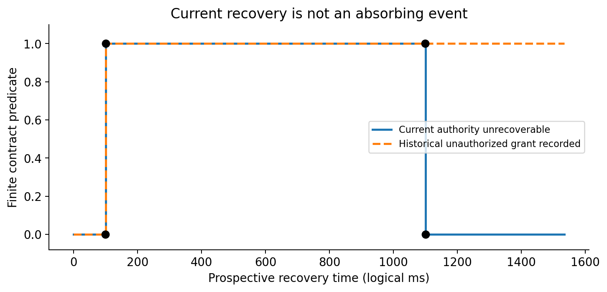
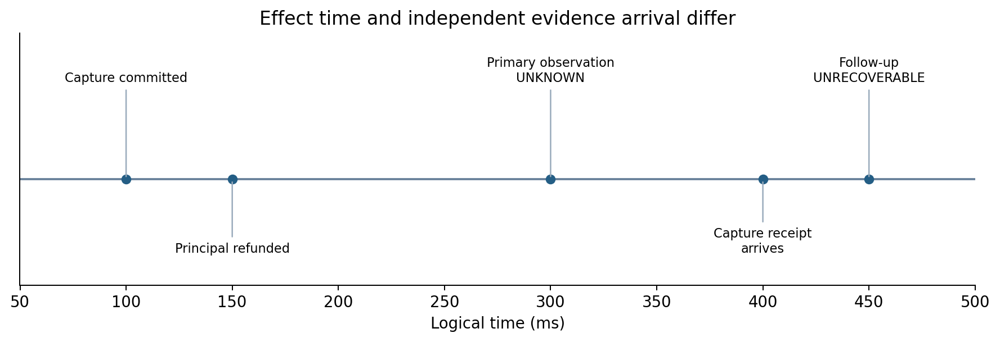
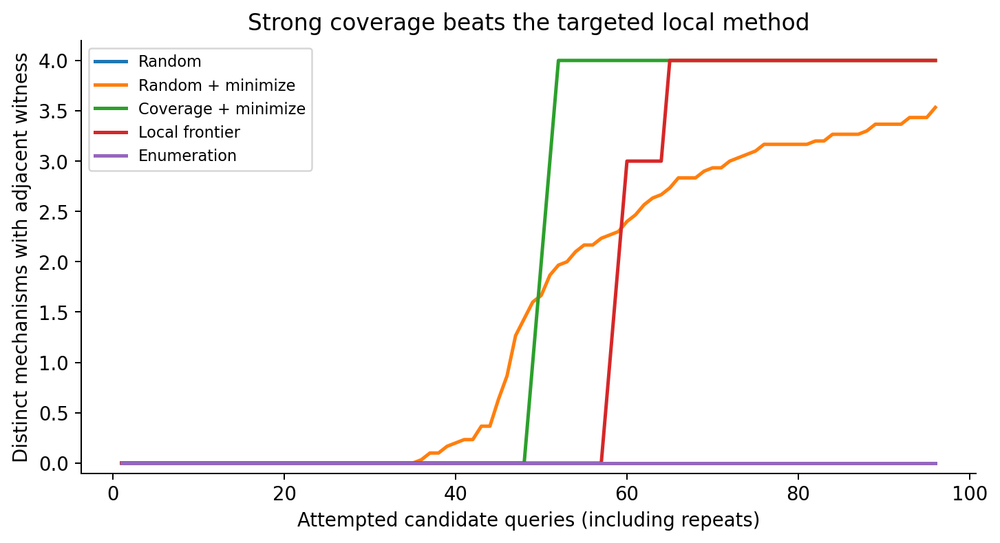
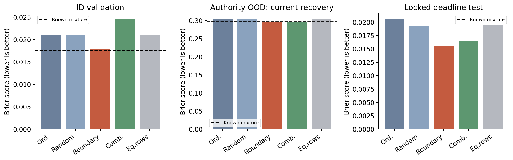
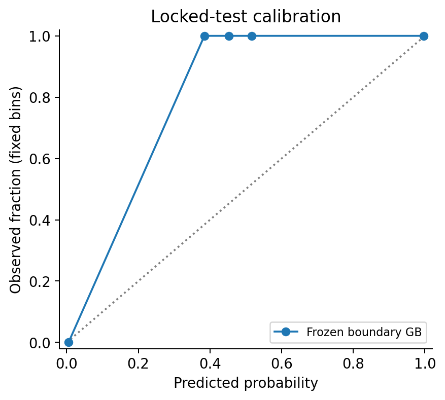
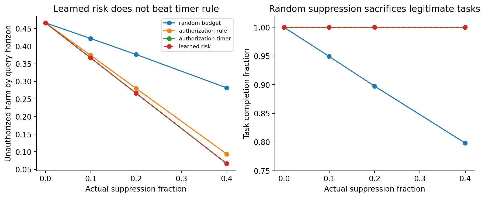

# AfterClick: Temporal Recovery Contracts and the Limits of Boundary-Focused Learning

Research artifact and paper draft — 23 November 2026. This is a bounded study, not a claim of
publication acceptance or established algorithmic novelty. Experimental source revisions, hashes,
protocol amendments and failed attempts are preserved in `artifacts/research_runs/`.

## Abstract

An agent can reverse a database edit after its external consequences can no longer be neutralized.
We study temporal recovery using executable contracts, isolated PostgreSQL consequence providers,
independent receipts, and a browser replay gateway. The artifact validates 102 planted backend
cases over four recovery obligations and one complete hybrid live-policy case. Exact finite closure
agrees with 63 known oracle assertions and shows that three partial implementations still admit
recovery. Five adjacent temporal transitions are independently re-executed in PostgreSQL. Under
matched candidate budgets, a targeted local explorer loses to coverage with the same minimizer.
A fixed tree trained on boundary data improves held-out Brier score over random counterfactual
data by 0.00369, but a specified no-learning mixture remains stronger. At matched task completion
and 409 interventions in 2,048 controlled cases, learned risk and a simple authorization-plus-timer
rule both reduce unauthorized harms from 955 to 546. A separate browser-input collision produces
opposite verified outcomes from identical public inputs. The evidence supports a reproducible,
limited benchmark and cautions against conflating recovery implementation, present recoverability,
historical effects, observability and predictive accuracy with an improved safety controller.

## 1. Motivation and questions

FlowBoard is a collaborative task application with autosave, field ownership, durable jobs and
notifications. A task's review flag can change dependent readiness and trigger downstream work.
The legitimate task in the initial controlled study changes an integration description. An extra
review is planted to investigate consequences; it was not spontaneously chosen by a language model.
Undoing the flag is insufficient if an independent recipient already observed the notification.

This study tests three hypotheses. H1 asks whether targeted timing exploration discovers verified
recovery boundaries more efficiently than strong generic search. H2 asks whether boundary-focused
labels improve calibrated prospective risk under an unseen effect mechanism, beyond generic data
and simple models at matched budgets. H3 asks whether learned risk reduces realized unauthorized
effects beyond strong simple controllers at matched utility or intervention burden.

None is presumed true. The purpose is to identify what the evidence supports, including a null
algorithmic result or a benchmark limitation. We do not infer natural agent mistake frequency,
production reliability or broad application generalization from planted cases.

## 2. Related work and scope of the proposed contribution

[Causal Agent Replay](https://arxiv.org/html/2606.08275v1) already studies step interventions and
stochastic continuation. Our outcome concerns feasible temporal recovery, not an improved causal
attribution estimator. [UndoBench](https://arxiv.org/html/2610.05622v1) is the closest benchmark
comparison: it combines paired fault trials, external effect histories, state oracles and execution
phases. AfterClick's candidate delta is adjacent timing witnesses and matched acquisition studies;
its workflow breadth is substantially smaller. No head-to-head performance claim is made.

[SURE-Act](https://arxiv.org/abs/2610.24194) already learns action control from counterfactual
outcomes. [Mnemosyne](https://arxiv.org/abs/2607.00269v3) and
[Planarian](https://arxiv.org/abs/2609.35366v1) cover important parts of admission, compensation
and state management. [ACRFence](https://arxiv.org/html/2603.20625v1) addresses irreversible effects
across restore. [Reversibility Classes](https://arxiv.org/html/2611.22075v1) makes declared recovery
assumptions and conservative gates explicit. These overlaps rule out novelty based on architecture
integration, a recovery taxonomy, or ordinary idempotent retries alone.

The [irreversibility-budget work](https://arxiv.org/html/2609.00275v1) studies cumulative runtime
exposure. [REVERSAL-BENCH](https://arxiv.org/abs/2609.17745v1) and
[Leave no Trace](https://arxiv.org/abs/1711.06782) establish broader precedents for recoverability
oracles and safety based on reset capability. Search also inherits conventional ideas from
[delta debugging](https://www.st.cs.uni-saarland.de/papers/tse2002/) and
[systematic concurrency testing](https://www.microsoft.com/en-us/research/publication/finding-and-reproducing-heisenbugs-in-concurrent-programs/).

The strongest current positioning is a small auditable temporal benchmark and mixed/negative
comparison. Publication-level uniqueness is not established. The source-linked literature matrix
records reading depth and avoids claiming absence of a technique from an abstract alone.

## 3. Recovery contract and observation model

Let x be world state at time t, x-minus the reconstructed suppressed-action reference, C the
required authorized state, I the independent legitimate changes, and A-t the admissible recovery
operations. Fixed-time recoverability means:

    R_C(x,t) = exists pi in A_t* : C(pi(x), x-minus) and I(pi(x)) = I(x).

Our finite contract fixes the clock during recovery. Operations compensate owned source state,
cancel pending external effects and refund principal. They cannot erase an independent recipient's
knowledge, recreate a burned fee, revoke a separately delegated child grant, or move a missed
immutable deadline into the future. Foreign-owned fields cannot be overwritten. Finite closure
searches all admissible operation orders; a failed implementation alone is not a proof of
unrecoverability. These guarantees are relative to the declared API, not universal physical law.

Waiting requires a separate time-budget contract. A child grant can remain impossible to revoke
instantaneously but expire later. Present recoverability can therefore return, while the historical
unauthorized grant remains recorded. Principal refund likewise compensates a payment without
removing its fee loss. Database restoration is not external recovery. A richer business policy
could change the acceptable contract; it would be a different target.

Epistemic labels are separate. UNKNOWN denotes insufficient trustworthy evidence, CENSORED an
unfinished observation horizon, CONFLICT an ownership constraint, and PARTIAL the attempted
procedure's residuals. Invalid reconstruction provides no causal classification. We preserve every
category and its denominator.

The predictive target is prospective recoverability at a query horizon h chosen before acting,
under a declared mixture of hidden consequences. It is not the absorbing target of the first
historical forbidden effect. Effect time, receipt arrival and available predictive information
must remain distinct.

Figure 1. Finite authority contract and actual PostgreSQL endpoint checks (black dots). The live
child prevents current recovery until expiry; its historical issuance does not disappear.

## 4. System and independently checked consequences

The existing React/FastAPI/PostgreSQL application, scheduler, Playwright gateway and conditional
compensation are preserved. Research uses isolated `ac_*` schemas. Counterfactual reconstruction
creates experimental worlds; snapshot restoration is never a live recovery operation. External
services and data are synthetic. There are no real payments, customer records, recipients or
publication endpoints.

Four obligation classes are evaluated:

| Obligation | Consequence | Recovery boundary |
| --- | --- | --- |
| Notification | Independent recipient observation | Cancellation before receipt; history persists after delivery |
| Fake fee | Principal transfer plus one burned unit | Pending cancellation; later refund cannot restore the fee |
| Delegated authority | Child grant outside parent-revocation API | Parent cancellation before mint; current residual ends at expiry |
| Deadline opportunity | Lease prevents a legitimate delivery by a fixed deadline | Release before deadline; a missed opportunity cannot be replayed in the past |

These are four obligation classes, not four permanently irreversible mechanisms. Delegation is
a deliberate nonmonotone control. The deadline cannot be extended under its declared API, and
financial irreversibility is simulated and capability-relative. Transport names do not count
as additional mechanisms.

Source, provider and receipt observer use separate schemas and transactions. Consumers react to
actual committed review events, not branch names. Oracles check source witnesses, external histories,
receipt/ledger agreement, conservation, reconstruction and independent-work preservation. Oracle
logic does not trust a planner's success annotation. Independence is architectural, not an external
human replication; a single developer can still introduce shared specification errors.

The first 48-case oracle pilot and the new 54-case pilot contain 102 enumerated development cases:
78 classifications outside UNKNOWN/CENSORED (including procedure/conflict classes), 12 UNKNOWN and 12 CENSORED, with zero execution-invalid cases. All expected
classes match. Projection into a 256-state finite model agrees with 63 positive/negative assertions;
three PARTIAL cases remain feasible. Conflict and epistemically incomplete cases are not turned
into physical impossibility judgments. This is consistency evidence, not a full abstraction proof
for every application state.

A delayed-receipt case commits capture at 100, refunds principal at 150, remains UNKNOWN at the
primary observation 300, receives the capture receipt 400, and verifies residual fee loss at the
predeclared follow-up 450. The original primary label remains unchanged.

Figure 2. Actual saved logical times; receiving evidence is not the same event as committing an effect.

## 5. Live-policy grounding and preserved failures

The user-designated Dedicated Endpoint was verified as Qwen/Qwen 3.5-4B at revision
`851bf6e806efd8d0a36b00ddf55e13ccb7b8cd0a`, API identifier `AfterClick`. Model outputs are constrained
JSON, temperature 0, thinking disabled, at most 256 output tokens and 16,384 input tokens, one
concurrent request and zero automatic generation retries. Actual requests, outputs and provider
metadata are retained. Temperature 0 is not assumed to guarantee deterministic inference.

The first new-endpoint run made 16 valid model decisions. A simple description task passed and a
two-action diagnostic failed. Six replay branches passed, then the lost-ack branch attempted a
new mutation while the UI showed an unresolved failed save. The Gateway correctly refused it.
The case is invalid: seven branches attempted, six valid, one invalid, five unattempted.

A separately preregistered arm added a deterministic visible-only guard: if the UI reports Failed
and exposes Retry save, retry the existing idempotent browser operation before requesting another
model mutation. It uses no server/oracle state. The arm made 19 model requests and produced one
complete 12-branch case with aligned prefixes, six recorded-action placebos, null equivalence and
verified committed lost acknowledgment. Recorded branches are not independent live policy samples.
The selected consequential action remains planted.

The multi-action diagnostic still failed. The minimum P1C scope was explicitly revised before the
successful run under the user's instruction permitting valid simple-task causal replay despite
that limitation. The unmodified failure is not relabeled. Two additional browser tests establish
that the risk-controller interface can suppress a real review mutation and preserve an explicitly
authorized review; they isolate enforceability with a stub scorer, not learned-model efficacy.

## 6. Search experiment: H1

Five explorers receive 96 attempted queries each over integer recovery times 0–1535, allocated
round-robin across four mechanisms. Thirty RNG seeds yield 14,400 candidate attempts. Repeated
queries remain charged. Random-plus-minimization, coverage-plus-minimization and the local explorer
share the same nearest opposite-label bracket minimizer. The local explorer uses exponential local
expansion; coverage explores the widest remaining interval. Plain random and enumeration are
weaker references, not the sole comparison.

A boundary requires adjacent observed times with different recovery labels. Deduplication uses
mechanism and semantic transition identity; child mint and expiry are distinct witnesses within
one mechanism. A separate 6,144-point reference grid is not free acquisition data for any searcher.
Every distinct discovered endpoint is then re-executed in PostgreSQL: ten endpoints validate five
transition witnesses across four mechanisms. SQL verification is a shared post-search audit, not
part of an asserted equal wall-clock-cost comparison.

| Method | Coverage AUC | Mechanisms at96 | Transition types | Delta vs coverage |
| --- | --- | --- | --- | --- |
| Random | 0 | 0 | 0 | -1.937500 |
| Random + minimize | 1.482639 | 3.533333 | 3.833333 | -0.454861 |
| Coverage + minimize | 1.937500 | 4 | 5 | 0.000000 |
| Local frontier | 1.520833 | 4 | 4 | -0.416667 |
| Enumeration | 0 | 0 | 0 | -1.937500 |

Figure 3. Mean distinct mechanism coverage versus attempted queries. All unique reported transitions
have independent SQL witnesses. The repetitions quantify algorithm RNG on fixed laws, not a
population of new mechanism discoveries.

The targeted local method's coverage AUC is 1.520833 versus 1.937500 for coverage, a difference of
−0.416667. Random-plus-minimization averages 1.482639; its paired difference against coverage has
95% interval [−0.571181,−0.339583]. Coverage finds all five transition types; local finds four.
H1's narrow advantage is not supported. The plain-random comparison alone would exaggerate the
case for targeting. We do not add evolutionary search to rescue it.

## 7. Data and risk prediction: H2

The learning experiment uses the executable finite abstraction grounded by the preceding SQL
checks. It is not a newly collected large browser-trajectory dataset. Eight acquisition campaigns
compare ordinary samples, random time-counterfactual pairs, boundary neighborhoods and combined
data. Each arm receives 512 attempted label queries, including four retained incomplete-measurement
probes. Overall 16,384 acquisition attempts include 64 UNKNOWN and 64 CENSORED rows. Search overhead
is charged; boundary acquisition cannot inspect the hidden transition time directly.

Boundary rows include the verified adjacent pair and nearby unique query horizons. Equal-row
ordinary subsamples control training size separately. All siblings of a source instance remain
in one partition. Source instance identifiers are synthetic task contexts with fixed causal laws;
they do not imply new mechanism diversity.

The predictor receives only the prospective query horizon, candidate action, explicit visible
task/effect consent and description readiness. It receives no mechanism ID, branch, seed, future
event, receipt time, oracle result or intervention label. A strict allowlist rejects hidden inputs.
The query horizon is a configuration available before acting, not a realized future latency.
Without that configuration, the visible-only ablation has much less predictive information.

Training uses notification and fee mechanisms; development selection uses separate source-instance
IDs from those mechanisms. Delegation is an untuned out-of-mechanism diagnostic. Deadline is the
final held-out mechanism. Its implementation and engineering tests were inspected during testbed
construction; "held out" means absent from model/threshold selection, not unknown to the developer.

Fixed predictors are an empirical base rate, a horizon 128 heuristic, a specified no-learning
training-mixture model, logistic regression,64 shallow boosted trees and a binned first-event
hazard estimator. A visible-only logistic model is an ablation. The hazard is approximate and
adaptive acquisition can violate independent-censoring assumptions. It must not be interpreted as
a correct survival model for nonmonotone current recovery. There is no hyperparameter sweep.
The mixture model knows the declared training law, but not the active consequence of an individual
case; this is a strong model-based reference with an explicit information assumption.

| Data | Mean training rows | Query budget | GB ID Brier | GB authority OOD Brier | GB final Brier | Known-mixture final Brier |
| --- | --- | --- | --- | --- | --- | --- |
| ordinary | 508 | 512 | 0.021073 | 0.304577 | 0.020585 | 0.014771 |
| random_cf | 508 | 512 | 0.021091 | 0.304232 | 0.019310 | 0.014771 |
| boundary | 486 | 512 | 0.017877 | 0.297560 | 0.015620 | 0.014771 |
| combined | 503.125000 | 512 | 0.024577 | 0.297511 | 0.016362 | 0.014771 |
| ordinary_equal_rows | 486 | 512 | 0.020980 | 0.303198 | 0.019553 | 0.014771 |

Figure 4. Boosted-tree Brier scores, means over eight acquisition campaigns. Panel scales differ.
The strong mixture reference is dashed. Authority expiry is a substantial distribution shift.

A constructive observability probe uses actual Chromium/SQL prefixes: the complete public task,
observation, history, candidate action and planned horizon 150 hash identically for notification
and fee worlds. Their independent outcomes are RECOVERABLE and UNRECOVERABLE. This is one
purposefully ambiguous benchmark pair, not a universal claim about real applications. Under an
equal mixture, any forecast for that identical input incurs conditional expected Brier loss at
least 0.25. More capacity cannot identify which unobserved world is active.

The locked deadline evaluation contains 2,048 finite rows in 64 source-instance clusters. Code,
protocol, datasets, selected model artifacts and controller settings were hashed before its single
opening. The primary selected-model contrast is exactly zero: all 40 development winners select
the same specified mixture, so boundary and random-CF predictions coincide. This is not a general
equivalence theorem. For the fixed tree, the secondary boundary-minus-random-CF Brier difference
is−0.003691, cluster 95% interval [−0.004837,−0.002699]. Yet boundary-tree Brier 0.015620 remains above
the mixture's 0.014771. Logistic and hazard contrasts do not share the tree improvement.

| Model | Ordinary Brier | Random CF Brier | Boundary Brier | Combined Brier |
| --- | --- | --- | --- | --- |
| base_rate | 0.068948 | 0.069073 | 0.210338 | 0.116298 |
| heuristic | 0.019531 | 0.019531 | 0.019531 | 0.019531 |
| known_mixture | 0.014771 | 0.014771 | 0.014771 | 0.014771 |
| logistic | 0.039288 | 0.039282 | 0.042960 | 0.043287 |
| gradient_boosting | 0.020585 | 0.019310 | 0.015620 | 0.016362 |
| discrete_hazard | 0.018438 | 0.018054 | 0.029797 | 0.025741 |
| visible_only_logistic | 0.068972 | 0.069294 | 0.210566 | 0.116846 |

Figure 5. Frozen boundary-tree calibration on the single held-out mechanism. Discrimination and
aggregate Brier score do not establish stable calibration under arbitrary hidden-mixture changes.

Thus H2 has a limited model-specific data effect, not the claimed general calibrated advantage
beyond strong references. The authority diagnostic's current-risk Brier near 0.298 further limits
an unseen-mechanism interpretation. No larger language model or post-holdout tuning is attempted.

## 8. Online intervention experiment: H3

The controller sees the current public features and past quota usage. At stream prefix n it may
suppress at most floor(B*n) actions. It never ranks using future task observations. Eligible
suppression uses random choice, explicit authorization, authorization plus a fixed horizon 128
rule, visible verification, or frozen learned risk ≥ 0.5. A mixture-risk reference is also retained.
The learned model is chosen by mean development Brier among trained predictors and deployed from
a prespecified replicate. Blocking happens before the candidate effect; unsupported staging or
approval powers are not simulated as prevention.

Synthetic tasks explicitly either authorize review and its documented downstream effect or request
a description-only task forbidding both. This makes authorization unusually clear. Successful
suppression preserves the description-only goal; suppressing required review fails a legitimate
task. Harm is an unauthorized historical effect by the prospective horizon, not a classifier error.
No natural human-preference inference is evaluated.

| Controller | Harms /2048 | Task completion | Interventions | Approval count | Extra verify operations |
| --- | --- | --- | --- | --- | --- |
| none | 955 | 1.000000 | 0 | 0 | 0 |
| random_budget | 771 | 0.897461 | 409 | 0 | 0 |
| authorization_rule | 574 | 1.000000 | 409 | 0 | 0 |
| authorization_timer | 546 | 1.000000 | 409 | 0 | 0 |
| always_verify | 574 | 1.000000 | 409 | 0 | 2048 |
| learned_risk | 546 | 1.000000 | 409 | 0 | 0 |
| known_mixture_risk | 546 | 1.000000 | 409 | 0 | 0 |

Figure 6. Actual suppression burden, harm and task completion. The random baseline sacrifices
legitimate work and is not the primary matched-utility comparator.

At B=0.2, learned and timer controllers both suppress 409/2,048 actions, preserve 100% task completion
and produce 546 harms versus 955 with no shield. Their paired harm difference is 0,95% cluster
interval [−0.001465,0.001465]. There is no demonstrated incremental benefit from learning. Approval
counts are zero; additional verification operations are modeled counts, not measured service latency.

A fresh 16-case PostgreSQL controller replay uses independently executed factual and suppressed
worlds. Decisions precede branch execution. No shield produces 8 unauthorized effects; rule, timer
and learned policies each produce 5 with three interventions and 16 completed goals. These are
purposive implementation audits, not population harm estimates. Two browser enforcement tests are
additional engineering evidence. Final-cohort independent-edit preservation is structural, with
no collaborator edits inserted; empirical preservation tests belong to the earlier oracle suite.

## 9. Cost, validity and reproducibility

The two new live runs make 35 model requests, with one complete and one invalid case retained.
Their conservative project guard charge is approximately $0.72. Delayed account-wide adjustments
make the net metered increase approximately $0.63; exact isolated invoices are unknown. Reported
conservative remaining credit is $27.48 with $0 billed, while the workspace cap is $3 and the effective default net
spend limit is $0. The user endpoint remains min 0/max 1 with zero containers verified after each run.
No new endpoint, token-billed Model API, fine-tuning or real external effect is used.

All later experiments cost $0 Modal. Measured active phases include 135.64s for the new 54-case pilot,
24.84s for search plus witness audit, 20.33s for learning development and 55.60s for locked evaluation.
The learning timer excludes cold imports. Exploratory `fit_seconds` fields include cumulative fit
and evaluation and must not be used as isolated per-model training latency.

The final checkpoint regression passes 239 tests in 172.43 seconds, including two browser enforcement
and two reproduction safeguards. One upstream deprecation warning remains. An earlier quota test
imposed a false requirement to spend the last token on an authorized request; its expectation was
corrected without changing the controller. A freeze-path bug was repaired from already saved models
without retraining. Failed traces remain archived.

Every run retains protocol, source hashes, trials, redacted model calls, certificates, metrics and
analysis. Figures and tables regenerate from saved data. Versions are pinned in the optional
research dependency group; existing application dependency versions were retained. Reproduction
is local-only and cannot launch paid experiments. See [reproduction instructions](REPRODUCE.md).

## 10. Threats, limitations and research status

The testbed has four fixed obligation classes and simple timing laws. One final mechanism is not
broad OOD evidence. Task contexts differ less than real workflows, and their bootstrap intervals
are conditional on this generator. The oracle/planner separation and separate receipts do not
replace external review. Finite closure validates a declared abstraction, not every concrete
recovery route. Our instantaneous contract excludes waiting, negotiation and policy changes.

Learning labels and most controller evaluations are finite-model executions, explicitly separated
from 102 SQL pilot cases, ten boundary endpoints, two observability outcomes and 16 confirmation
spots. Reusing the pilots for formal checks does not add 102 independent observations. The live
case grounds the replay system, not a claim that the learning dataset represents organic policy
mistakes. The multi-action model limitation remains unresolved.

The strong mixture reference assumes known training dynamics. Outcomes can change when that
mixture changes invisibly. Boundary sampling may improve a particular approximation without solving
that identification problem or improving the best simple controller. Suppression at matched utility
is feasible here because visible synthetic consent is explicit; real ambiguous authorization and
long-horizon utility remain outside the evidence.

The literature overlap is substantial. This draft supports a bounded temporal benchmark, constructive
counterexamples and mixed/negative comparisons. It does not establish a novel general algorithm,
broad calibrated learning gain, learned-control superiority or publication readiness. No code or
data are published automatically. The next informative study is an independently implemented
workload/schedule-distribution replication with genuinely available public signals and newly frozen
instances, rather than further tuning on this final set.

## 11. Conclusion

AfterClick makes temporal recovery assumptions executable and falsifiable. Its controlled evidence
separates successful implementation from feasible recovery, present authority from historical effects,
and effect commitment from evidence arrival. Strong coverage defeats the targeted local explorer;
boundary data help a fixed tree but not the selected model beyond a strong reference; learned risk
prevents harm without beating a simple timer rule. These are useful bounded findings, not evidence
for the original broad superiority claims.
