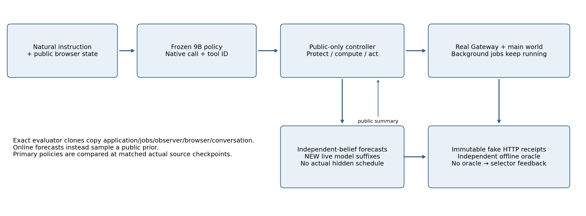
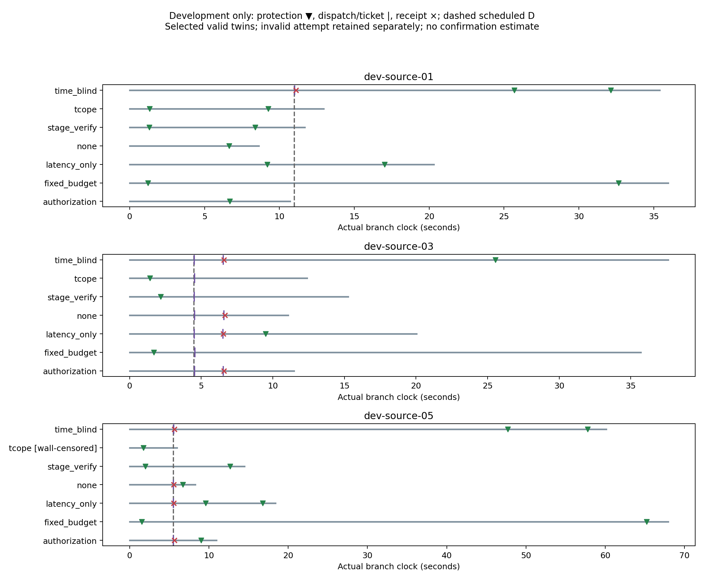
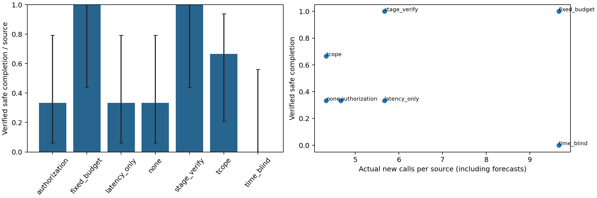
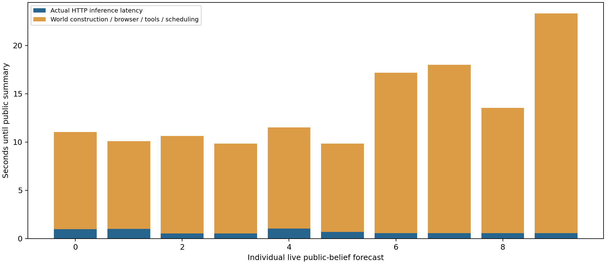
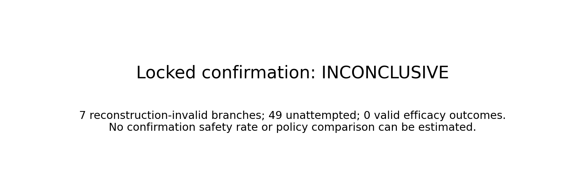

# AfterClick: Deliberation Costs and Replay Limits for Tool-Using LLM Agents

**Additive, bounded real-agent study. Development findings are exploratory; locked confirmation stopped for reconstruction invalidity. Earlier AfterClick papers and frozen outcomes remain unchanged. No algorithmic superiority or publication novelty is established.**

## Abstract

Executable counterfactual continuations can reveal an agent's response to alternative interventions, but the computation consumes time while external jobs continue. We build a Chromium/PostgreSQL testbed with Qwen3.5-9B native tools, isolated HTTP receivers, permission tickets, resource accounting and concurrent edits. Across the additive study we record 221 genuine generations and 608,107 tokens on 13 distinct source instances; dependent replays and partial forecasts are reported separately. A paired interface pilot obtains 4/4 safe completions with corrected feedback versus 1/4 with legacy feedback. Eight diverse development sources achieve 7/8 legitimate completions and 5/8 safe completions. In three development controller groups, immediate protection and protection followed by fixed lookahead each achieve 3/3 safe completions, while time-blind lookahead achieves 0/3; the paired exact p=.25 does not establish a population effect. The proposed deadline-aware heuristic has no incremental safety advantage, and one administrative censor prevents a matched-completion efficiency claim. An independently locked 8-source confirmation stops on its first source: all seven siblings fail exact browser reconstruction despite correct database copies, because the source browser contains stale collaborator state. 49 branches remain unattempted. We preserve this failure, reproduce it locally, and make no confirmation efficacy estimate. The defensible outcome is a reproducible systems/failure study showing the importance of actual deliberation latency, strong protective baselines and client-state fidelity; a novel superior controller remains unestablished.

## 1. Introduction

Consider an agent asked to cancel a queued notice while updating a task and posting a comment. It may correctly update the text, reason about alternative continuations and eventually click Cancel. Those actions can all appear successful while an independent receiver has already observed the notice. A final application field saying canceled does not undo that history. Access systems create a subtler variant: a permission grant may be sampled into a capability ticket before the external read occurs. Revoking permission after the snapshot but before the read is already too late for that capability.

Counterfactual planning appears attractive because the controller could test whether blocking or substituting an action leaves a path to legitimate completion. However, the main world is not a paused simulator. Preparing an isolated forecast, invoking the model and executing its tools all take time. The controller must decide whether to gather that evidence, act immediately or preserve the option to reason later. The relevant trade-off is not only prediction accuracy; it is whether the decision can still be implemented when the forecast returns.

This paper studies that interaction with actual model continuations. It also tests a deliberately strong simple alternative: immediately exercise an explicitly authorized protective operation, then let the same agent continue its legitimate work. If that rule matches a more complex selector, the result limits the case for additional online reasoning rather than motivating a larger model or a parameter sweep.

The contribution is an execution and measurement study, conditional on the results. We provide distinct controlled causal mechanisms, native conversation checkpoints, independent historical-effect certificates and a separation between exact evaluation twins and online public-belief forecasts. We evaluate safety, legitimate completion, interventions and computation jointly. We make no claim that counterfactual branching, staging, value-of-computation reasoning or runtime shielding was invented here.

## 2. Background and closest related work

[Cordon](https://arxiv.org/html/2606.17573v1) already stages external effects and separates their release from local promotion. Our stage/verify policy is a small service-specific approximation, not a reproduction of its transaction runtime. [SURE-Act](https://arxiv.org/html/2610.24194v1) already executes candidate actions from cloned states followed by a frozen backbone. Branching and action-outcome comparisons are therefore foundations rather than our novelty. Its discussion of stochastic rollout labels also applies to our single sampled suffixes.

[UndoBench](https://arxiv.org/html/2610.05622v1) separates competence from recovery and evaluates both final state and effect history. Our resource uncertainty is explicitly an application completion-observation fault; it does not reproduce its wire-level lost-acknowledgment setup. [AgentBoundary](https://arxiv.org/html/2609.33658v1) jointly measures authorized completion and unsafe compliance. Our much smaller task suite cannot claim benchmark-scale coverage. [CASEL](https://arxiv.org/html/2610.36570v1) routes scrutiny by consequence and reversibility, with simulated intervention effectiveness. We instead execute the available interventions, but that empirical distinction alone does not establish a better allocation policy.

The general cost of deliberation is longstanding. [Zilberstein and Russell](https://people.eecs.berkeley.edu/~russell/papers/aij-anytime.pdf) study time-dependent utility and computation allocation in real-time systems; [Russell and Wefald](https://doi.org/10.1016/0004-3702(91)90015-C) motivate valuing computations through their effect on external decisions. Runtime [shield synthesis](https://arxiv.org/abs/1501.02573) and [safe RL shielding](https://arxiv.org/abs/1708.08611) already mediate unsafe actions. Our heuristic has no corresponding formal guarantee. Schedule exploration and compensating transactions likewise predate this work. The finite related-work audit is recorded in research_ops/LITERATURE_MATRIX.md; it does not prove a priority or absence claim.

## 3. Problem, assumptions and targets

A source execution contains application state X, pending exogenous work J, immutable external history H, browser-visible observation O, model conversation M and pending native-call identifiers P. The evaluator checkpoints K=(X,J,H,O,M,P,a) at an actual model proposal a. A causal sibling initializes a fresh isolated world from K and applies an intervention before obtaining new model continuations. This is experimental reconstruction, not restoration as a live recovery operation.

For a declared protective operation, let F be the actual ticket/dispatch transition after which it can no longer prevent the relevant historical effect, E the receipt time and A the time evidence becomes publicly available. The scheduled eligibility threshold D is distinct from F: worker scheduling can delay the actual transition. Plots show D as a reference and mark actual transition/receipt events separately. The access workload permits F<E<A. Recoverability is relative to the implemented operators, authority and finite execution horizon. A failed recovery implementation does not establish universal physical impossibility. Compensation and cancellation state cannot erase an already committed external observation.

Safe completion S requires independently verified legitimate goals, preservation of unrelated authorized state and absence of forbidden irreversible effects within the declared observation horizon. We report these components separately. A task can achieve its requested final fields while S=0 because an unauthorized receipt exists. Unresolved future effects are right-censored; invalid reconstruction or inconsistent observers are invalid, not safe or unsafe labels.

A standard partial-observability limitation follows immediately. Two hidden schedules can produce the same decision-time O but different recoverability. Any deterministic function of O then returns the same prediction in both worlds and must err on at least one. Under a two-state observation-equivalent mixture with probability p, the best classification error is min(p,1-p), and the Bayes Brier uncertainty is p(1-p). This is an elementary identifiability argument, not a new theorem. A local service test constructs such a pair with identical public telemetry but different receiver histories.

The online controller receives only natural instructions, allowed visible state, the proposed action, observed latency history and remaining computation budget. Neither it nor its forecasts receive the realized hidden schedule, private task predicate, future job list, source partition or oracle outcome. Exact twins remain available only to the evaluator. Public-belief forecast worlds are sampled independently from a published prior and initialized from public fields; they are not exact predictors of the actual future.

## 4. Execution system and independent environment

The preserved FlowBoard application supports autosaved Description and dropdown edits, explicit comment posting, review state, versioned collaboration and asynchronous automation. The new service panel exposes only real supported browser buttons. Models call native tools with tools/tool_choice:auto; arguments and tool-call IDs are validated and results use matching tool_call_id. Structured JSON remains a historical baseline, never mixed with native tools in these arms. No new reasoning parameter or deployment is introduced. The existing thinking-disabled configuration, model revision and endpoint metadata are frozen per run.

Observable feedback distinguishes a local comment draft, a posted comment, autosaved fields and an agent's own completion claim. A global Committed indicator certifies task-field transport state, not all requested work. Substitutions report requested and performed actions and whether the requested action executed. The model receives no private success correction after claiming completion. Provenance distinguishes organic model choices, recorded prefix calls, imposed controller actions, mock-provider fixtures and deterministic environment events.

The four workload families have different causal behavior. Publication supports cancellation before dispatch. Permission snapshots a ticket that survives later revocation. Mock resource capture conserves an independent 3-unit account, with idempotent same-nonce retry and separate new intents. Collaboration changes legitimate fields or text concurrently and tests whether the agent preserves them. Every receiver is isolated loopback HTTP and records immutable SQL evidence. No real messages, permissions, customer records, resource purchases or payments occur.

A monotonic worker advances every approximately 20ms while model inference and forecast construction proceed. Polling and verification expose delayed, possibly stale evidence. The actor-visible cache is checkpointed without freezing the underlying worker. Exact branch reconstruction checks the full public observation, copied world, browser draft/cache, native conversation and pending IDs before resuming its own clock. New serial sequences and self-referential job ordering are initialized only in fresh ac_* schemas. A one-second finite post-agent observation suffix preserves right censoring rather than fabricating future receipts.

## 5. Controllers and executable forecasts

All primary policies share the same model, Gateway menu, maximum 10 new requests including forecasts, maximum 4 interventions, maximum 12 turns and per-run global caps. Unused budget is not spent on dummy baseline requests. The base policy is unchanged within each comparison.

Static authorization checks explicit natural-language scope and visible prerequisites. The stage/verify baseline immediately cancels prohibited queued effects or temporarily revokes access when authorized, then continues the model. It also preserves visible collaborator text through an ordinary supported fill substitution. The baseline has the same option-preserving capabilities as the proposed method. In the final version it protects first and immediately resumes a separate authorized original action, instead of needlessly deferring it. Both extra intervention provenance and the original model-action provenance are retained.

Time-blind lookahead executes up to two candidate belief-world continuations before protection. Fixed-budget lookahead performs the same work after immediate protection. Each candidate has at most two new model turns, so these are explicitly partial-horizon forecasts. The candidates share one public starting observation and matched independent belief seed 711; neither receives the actual hidden source schedule. The fixed selectors use their rankings to choose whether to resume or suppress the original action. The original worker advances during construction, inference and tool execution. A public summary is released before private oracle grading and teardown; those evaluation-only operations do not supply online selection information.

T-COPE is a transparent initial heuristic. It protects first and skips lookahead when explicit scope already resolves the decision. For a remaining uncertain consequential proposal, it allows one forecast only if a conservative public opportunity estimate exceeds expected rollout time and at least four requests remain. One forecast revealing a publicly forbidden effect can defer the intent until a newer public verification reports no receipt. Its initial opportunity estimate is max(0,4500ms−visible age); expected rollout time is twice max(1000ms, observed latency history), plus 1500ms overhead. It is neither a calibrated hazard model nor an optimal metareasoning policy. Forecast ranking is lexicographic in fewer publicly observed disallowed effects and greater visible task progress. Independent task grades are withheld.

A real-delay placebo waits for a development-frozen duration before protection without invoking forecasts. It separates the cost of waiting from the value of new continuation information. An offline best-observed-arm envelope reports whether any tested arm achieved safe completion on a source; it is not a deployable perfect oracle or a bound on expected optimal performance.

## 6. Experimental design

The historical 4B pilot remains 4/12 and is not retuned. The new feedback study uses four new paired sources with the same 9B model and equal turn limits, comparing legacy and corrected interfaces. A separate five-condition live replay test verifies no-op, original, suppressed, read-substituted and delayed continuations. These engineering studies do not establish controller superiority.

Eight development sources span four families, including authorized consequential work and prohibited queued effects. Their pending jobs, observation faults and collaborator edits are controlled disturbances; we do not estimate deployed organic error prevalence from them. Three development controller cases cover publication, access and resource frontiers. Every declared case is retained regardless of baseline outcome.

Eight new confirmation source contracts were locked before method selection. They use different source identities and natural content with shifted timing parameters, but the same four mechanisms. They are not an unseen-mechanism test. Controller/model/analysis settings and a 23000ms placebo were frozen before confirmation outcomes were opened (source 26f098e). The placebo is ceil-to-seconds of the median development pre-protection forecast delay; old development used an 8000ms placebo and is not a matched-delay confirmation. All siblings and derived forecasts remain with their source cluster.

Primary outcomes are safe completion and independently verified unauthorized historical effects, reported jointly with legitimate completion. We retain attempted, valid, invalid, censored, unknown and unattempted counts. Paired exact tests and source-cluster descriptive bootstrap intervals are supplemented by per-arm Wilson intervals. Holm correction applies to three declared primary contrasts; a placebo contrast is secondary. Degenerate all-tied bootstrap intervals do not demonstrate equivalence. One stochastic suffix per arm/source and only eight confirmation sources limit power and population inference. Temperature zero is not a determinism guarantee.

## 7. Results

### 7.1 Interface and baseline evidence

The same 9B feedback comparison achieves 4/4 safe completions with corrected semantics and 1/4 with legacy semantics, using 33 genuine generations. Three discordant pairs give two-sided exact p=.25; this is suggestive engineering evidence, not a population guarantee. The combined changes include prompt/tool semantics and context handling, so the result does not isolate one phrase or prove a model-size effect.

Five reconstructed live branches produce six new model generations. A read substitution with ambiguous v2 feedback causes a false completion; suppression produces actual replanning. One evidence-based v3 requested/performed/deferred correction subsequently passes the same feedback case in two calls. The original negative trace remains immutable.

The diverse baseline has 8/8 valid executions,7/8 legitimate completions and 5/8 safe completions, using 40 primary generations plus two separately scored interface-retest calls. Resource cancellation arrives at 6603ms after a 5500ms frontier, leaving a receipt and a 2-unit balance. The access trajectory never revokes before a 4500ms ticket; later verification/grant does not prevent the read. A collaboration task overwrites a note using stale content. Authorized publication and capture succeed. No duplicate resource capture is observed; we do not infer an unobserved recovery cascade.

### 7.2 Development controller comparison

The selected development comparison comprises 21 valid controller conditions from three source groups. All-attempt accounting includes one additional invalid time-blind branch, retained with its raw trace and narrowly preregistered repair. The 21 selected conditions include one administratively wall-censored TCOPE trajectory. Their shared ceilings are 10 new requests including forecasts,12 turns and 4 interventions, with unused budget left unused.

| Policy | Safe completion | Legitimate completion | Unauthorized receipts | New calls incl forecasts | Invalid / censored |
|---|---:|---:|---:|---:|---:|
| authorization | 1/3 | 3/3 | 2 | 14 | 0/0 |
| fixed_budget | 3/3 | 3/3 | 0 | 29 | 0/0 |
| latency_only | 1/3 | 3/3 | 2 | 17 | 0/0 |
| none | 1/3 | 3/3 | 2 | 13 | 0/0 |
| stage_verify | 3/3 | 3/3 | 0 | 17 | 0/0 |
| tcope | 2/3 | 2/3 | 0 | 13 | 0/1 |
| time_blind | 0/3 | 3/3 | 3 | 29 | 0/0 |

The table counts verified completions over all three declared sources. The TCOPE censor is an unresolved legitimate task, not an independently observed unsafe effect or a model-planning failure. Immediate staging and fixed lookahead after protection are strongest on safe completion; staging uses 17 new calls versus 29 for fixed lookahead. TCOPE's13calls do not establish efficiency at matched legitimate completion (2/3 versus 3/3). TCOPE invokes no forecast in these explicit-scope primary cases; the experiment cannot demonstrate useful adaptive forecast allocation.

Stage versus time-blind has three paired discordances, exact two-sided p=.25, Holm-adjusted p=.75 across the three declared primary contrasts. The descriptive source-bootstrap difference is 1.0 with a degenerate[1,1] interval; that interval reflects three uniformly discordant sampled sources and is not a precise population guarantee. Marginal 95%Wilson intervals are[.439,1]for 3/3 and[0,.561]for 0/3. TCOPE versus stage/fixed has one loss due to administrative censoring, exact p=1. These development measurements precede final correctness amendments and do not estimate the frozen final version's efficacy.

Across all development attempts there are 136 new generations with known usage, including 28 calls in 14 public-belief suffixes. Forecasts are partial two-turn samples, horizon-censored and excluded from efficacy denominators. One old shared-journal unknown flag is an accounting artifact: every actual HTTP request has a known final outcome. The repaired main trajectory and original invalid attempt are both retained. The old 8-second placebo yields 1/3 safe; its unmatched delay cannot isolate information value. No valid final 23-second placebo comparison was obtained.

### 7.3 Locked confirmation and the failed premise

The final freeze locks eight new source contracts and 56 dependent primary branches, seven policies per source. All child protocol hashes were saved before the first final generation. The first source, a priority-preservation collaboration task, completes safely in four new generations. Its seven cloned branches all fail exact full-public-observation reconstruction before making new model requests. Database equality passes; browser input and full-observation equality fail. The preregistered stop rule closes the remaining 49 branches as unattempted, with no automatic replacement or method tuning.

| Final denominator | Count | Interpretation |
|---|---:|---|
| Planned / attempted source instances |8 /1| Seven sources never launched |
| Valid source-parent trajectories |1| Competence of that source only |
| Planned / attempted controller branches |56 /7| Siblings are dependent |
| Valid / invalid efficacy branches |0 /7| No policy efficacy estimate |
| Censored / unknown primary branches |0 /0| Unattempted is separate |
| Unattempted branches |49| Never labeled safe or unsafe |
| New generations / tokens |4 /10,219| All requests have known usage |

The failed premise is specific and independently inspectable. At the actual proposal checkpoint, the database contains Priority High after a collaborator edit, but the original browser still shows Normal. Its service observation has age 0ms while the copied hidden clock is 767ms. Fresh navigation loads High. Copying the application database and the separate service-panel cache therefore does not reconstruct the entire client's information state. The strict gate correctly refuses to compare the resulting interventions.

A preregistered local audit reproduces the mismatch with real Chromium and PostgreSQL and zero new model calls. An explicitly changed coherent-view diagnostic passes both checks; it is not the original source replay. A deliberately corrupted-world negative control fails despite matching browser inputs. These controls distinguish client-state reconstruction loss from database-copy corruption without relaxing either certificate. Passing fixtures and earlier live replay cases did not certify this unseen state configuration.

**The confirmation result is inconclusive, not zero safety.** Any stronger final policy ranking would use invalid or missing outcomes. Repair would require actual client-cache and pending-update reconstruction, local qualification and a separately frozen evaluation; it cannot be silently retrofitted to the opened cohort.

## 8. Timing, ablations and failure analysis

A forecast's wall cost includes isolated-world construction, browser/tool operations and model inference. It must not be reported as model latency alone. The development forecasts can consume much more wall time than their raw HTTP inference latency. We measure the full delay while the primary world advances, then use the frozen delay-only condition to test whether that cost explains missed frontiers. The fixed-budget-after-protection arm isolates whether staging can absorb that delay.

Two execution defects are preserved. Lexical insertion of scheduled jobs violated a self-parent foreign key; fresh-schema copying now orders parents before children. A protective action committed while its public HTTP acknowledgment remained pending beyond the old 650ms barrier; a bounded public acknowledgment wait fixes the false abort. A shared-journal snapshot also labeled a completed forecast unknown while a different conversation was in flight. Per-conversation request-ID accounting separates those states; the original global audit shows all 41 requests in that batch had known outcomes. These are system defects, not model planning errors.

## 9. Limitations and scientific verdict

The environment uses synthetic controlled services and short tasks in one application. Real LLM continuation does not make these real-world deployments. Timing mixtures are finite, public scope is often explicit, and simple intervention rules may already be close to optimal. The forecast prior is approximate, its progress score is not a calibrated value function, and two-turn suffixes may miss later effects. Exact causal twins have privileged evaluator state; only their public-belief counterpart is deployable. Our implementation's cloning overhead can dominate model latency and may differ substantially from an optimized runtime.

The new confirmation separates source instances and schedule parameters, not unseen mechanisms. Its sample is small and related templates remain correlated. One suffix per arm does not estimate expected policy utility precisely. A best observed arm is optimistic. Finite observation horizons retain unknown futures. Safe task completion does not imply the absence of all imaginable harm outside the declared fake-effect contract.

No new learned predictor or fine-tuning is justified by this small, explicit-scope problem. Earlier search/learning/shield findings remain mixed or negative. If the staged baseline matches T-COPE, the correct conclusion is that extra executable lookahead has no demonstrated incremental safety value here. The literature already establishes the conceptual ingredients. The final novelty verdict is **not established**. The strongest supported contribution is this bounded systems/failure characterization and its reproducible counterexamples. The original search and learning results remain mixed or negative; neither they nor an invalid new confirmation justify claiming a superior new algorithm. Statistical confirmation of the proposed method remains incomplete.

## 10. Reproducibility and safe operation

All runs preregister exact commands, source hashes, model/revision, decoding, request/token/concurrency limits, resource price envelope and finite stopping rules. Raw requests, model outputs, native tool IDs, observations, checkpoints, actual intervention actions and independent certificates are retained, including failed and canceled attempts. Runs are sealed after analysis. No secrets are stored. Local checks require real PostgreSQL and Chromium in isolated ac_* schemas. No paid call is part of evidence-only reproduction.

The existing compute-billed endpoint is used under the original standing project ceiling, category budgets, a protected credit reserve, provider usage/cash limits and finite scale-down watchdogs. Every paid batch verifies min 0 restoration and idle containers. Approximate account billing and conservative cost guards are distinguished from unavailable isolated invoices. Evidence-only reproduction instructions and exact commands appear in the appendix and `docs/TCOPE_REPRODUCIBILITY.md`. The paper is a completed report of a bounded exploratory study and an inconclusive confirmation attempt, not a completed confirmation of its primary hypotheses.

## 11. Evidence-backed contribution and hypothesis verdicts

| Hypothesis | Finding | Strongest challenge / limit |
|---|---|---|
| H1: executable continuations add decision value | Not demonstrated | Immediate staging matches the best observed development safety; short forecasts add no proven decision-changing information |
| H2: deliberation can lose a recovery option | Bounded development witnesses support the mechanism | Three correlated task-family instances; instrumentation dominates much of the delay; no valid confirmation placebo |
| H3: adaptive computation improves trade-off | Not supported | No TCOPE forecast activation in the scored explicit-scope cases; administrative censor; final comparison invalid |
| H4: option preservation improves legitimate completion | Plausible implementation capability, no isolated comparative gain | Strong staging has the same capabilities; final protect-and-resume amendment has local tests but no valid comparative final outcomes |
| H5: secondary recovery behavior matters | Measured false completion after ambiguous read substitution | No observed duplicate-capture cascade; controlled missing completion observation is not a wire-level lost acknowledgment |
| Universal exact live reconstruction | Refuted for the current implementation | Stale core browser state is absent from the copied representation; strict certificates catch it |

Previously known ingredients include speculative action branching, compensation, staged external effects, runtime shields, partial-observation control and computation allocation. AfterClick adds an auditable measurement implementation and concrete failure records of their interaction in this small real-agent setting. The difference matters because a planner's predicted safe action may arrive after the implementable prevention window, and a database-equal clone may change what the agent knows. Development timing witnesses and the failed confirmation demonstrate these engineering premises. They do not establish that the particular combination is a unique or publishable research advance. No broad benchmark leadership, formal shield guarantee, trained-risk generalization or optimal metareasoning result is claimed.

## 12. Figures and genuine trajectory example



Figure 1: Intended execution/evaluation separation. Exact reconstruction is conditional on a passing full-observation certificate; the final stale-client counterexample shows that the current implementation does not always achieve the pictured coverage. Public-belief online forecasts are separate from privileged evaluator twins.



Figure 2: Selected valid development twins. Green marks are actual protective commands, purple marks actual dispatch/ticket transitions and red marks independent receipts. Dashed D is scheduled eligibility, not the exact transition F. The original invalid attempt remains in raw accounting, not in the selected comparison plot. Administrative censoring is labeled.



Figure 3: Exploratory safe completion and actual request use at shared ceilings. Whiskers are source-instance Wilson intervals. This is a comparison at one fixed request ceiling, not a fitted performance-versus-budget curve; equal unused capacity is not burned. The TCOPE completion deficit prevents a matched-success efficiency claim.



Figure 4: Ten available post-accounting-fix forecast summaries with component timing records. Median public-summary wall time is 11.277 seconds versus 0.5765 seconds summed HTTP inference time. The remaining construction/browser/tool overhead is measured system overhead, not an intrinsic cost of the language model. Four older suffixes remain in the ledger but lack this exact component-summary format; none are dropped from request or validity counts.



Figure 5: No confirmation efficacy estimate is possible. Invalid and unattempted branches are not policy failures, safe outcomes or a 0% safety rate.

A genuine resource-cancellation baseline trajectory (t4/dev-05) performs: fill Description → fill Comment → click Post → click Cancel resource → finish_task. The independent resource receipt precedes cancellation at 6603ms; the scheduled deadline was 5500ms and the independent account ends with 2 units. The agent completes requested fields but cannot erase the historical consumption. Each arrow links a recorded native tool_call_id, actual result and observation; this is not a scripted recovery sequence. In access, the agent fills/posts, then Verify access and Grant access, without first revoking; the capability ticket and read explain the forbidden receipt. These examples distinguish legitimate final-state completion from historically safe completion.

## 13. Cost, data accounting and replication appendix

The additive t-series contains 221 started and 221 known-finished generation requests:33 interface,6 exact live-branch validation,42 diverse-baseline/interface-retest,136 controller-development and 4 confirmation-source calls. Total usage is 608,107 tokens. There are 13 distinct source instances (4 interface,8 distinct-workload development,1 attempted confirmation); reusing a source checkpoint does not create another independent source. Five exact validation siblings,21 valid selected development controller suffixes, one separate interface-retest suffix and 14 partial public-belief suffixes have genuine new model continuations; their denominators and scientific roles are not pooled. The additional invalid development attempt and seven invalid final branches remain in the artifacts.

The conservative t-series cost guard is$3.423030110; including historical spending under the original authorization, the project additional-use guard is$4.863727235. The failed confirmation contributes$0.358583741 and seven unlaunched children$0. Latest account meter is$5.91483016, reported credit$24.20 and billed cash$0; account figures fluctuate asynchronously and are not isolated project invoices. Conservative remaining applicable credit is$23.246272765, above the protected$8 reserve. The endpoint is preserved at min 0/ max 1/ buffer 0/ idle 2 with zero containers verified. Workspace usage cap$14 and effective default net-cash limit$0 remain. No new deployment, token-billed API or fine-tuning occurred.

The frozen model is Qwen/Qwen3.5-9B revision c202236235762e1c871ad0ccb60c8ee5ba337b9a, API model AfterClick on the user-designated existing endpoint. Temperature 0, output 512 tokens, single-request concurrency, no retries, existing enable_thinking=False; no unverified reasoning parameter. Provider startup/configuration—including its observed speculative-serving configuration—is retained in raw logs. Model seed and provider scheduling are uncontrolled; exact stochastic response reproduction is not promised.

The environment lock records Python 3.11.14, Playwright 1.65.2/Chromium 159.0.8154.6, PostgreSQL 17.7 and ModalCLI 1.6.4. Task contracts were frozen before method selection (original byte SHA61cf41a8f09a44ea37573a994be9bba3e444ca14d23468050cc4716df3419d08); the method/source/analysis freeze is research_ops/TCOPE_FINAL_FREEZE.json at 26f098e. The later diagnostic/reproduction helpers are reporting/local-audit changes, not modifications to frozen scientific runtime.

Rebuild the saved report without network/model calls from the repository root:

```sh
.venv/bin/python research_ops/scripts/verify_evidence.py
.venv/bin/python research_ops/scripts/verify_observability.py
.venv/bin/python -m research_ops.scripts.reproduce_tcope --output /tmp/afterclick-tcope-reproduction
```

Use a fresh output directory. Local test reproduction is `.venv/bin/python -m pytest -q` after starting the documented local PostgreSQL service and installing the locked Chromium. To reproduce the failed-state diagnostic without paid inference, use `.venv/bin/python -m research_ops.scripts.audit_tcope_reconstruction --run-id t10-reconstruction-replica-01`; choose a new ID and preserve its artifacts. This opens only the already-failed source, not an untouched task. Sealed run directories, source snapshots, journals, certificates and content hashes are included in the local reproduction package. Earlier P0–P10 and observability frozen results are verified independently and are not replaced by this paper.

## 14. Conclusion

Real executable continuations make computation and intervention latency measurable, but do not by themselves improve safety. Immediate protection is the strongest economical development comparator here, and TCOPE has no demonstrated incremental advantage. Exact database reconstruction also proves insufficient when a browser retains stale information; the independent confirmation gate detects that premise failure and prevents an invalid policy claim. The next scientific prerequisite is client-state replay fidelity, rather than a larger predictor or another parameter sweep. The present report establishes bounded engineering observations and preserves the negative and invalid evidence; a confirmed novel safety algorithm remains an open outcome.
