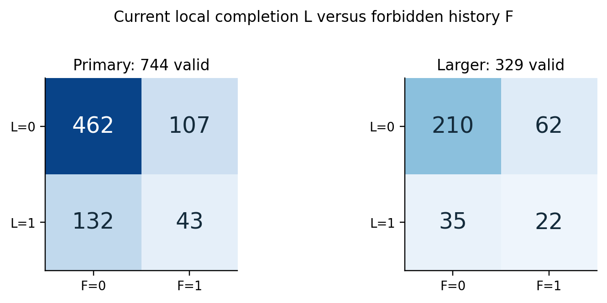
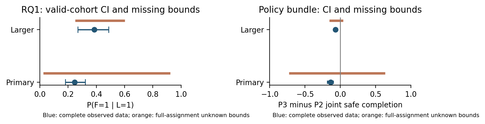

# AfterClick: Admission, Irreversible Effects, and Restoration in Asynchronous Agent Workflows

Anonymous manuscript. 26 November 2026.

## Abstract

An agent can finish its local task after an external effect has already violated the task's authorization. Protecting a workflow also creates a second requirement: restoring legitimate functionality. We study these distinctions in two PostgreSQL-backed applications with progressing workers, browser interaction, and synthetic HTTP receivers. Our analysis preserves the complete disposition of a partially executed frozen evaluation: 1,479 of 2,904 assignments have terminal records; 1,425 remain unexecuted. Among valid internal episodes with current local goals complete, forbidden effect history occurs in 43/175 primary-model and 22/57 larger-model episodes. A separately enrolled, fixed-recommendation actuator experiment records an increase of 27.8 percentage points in forbidden history for an imposed 300 ms browser delay. A source audit corrects an earlier interpretation: admission and protection already share a database lock. All 34 examined late-receipt cases instead show admission before protection. 72 new barrier probes reproduce this non-revocable-ticket boundary. We reconstruct 617 protection-induced restoration duties and replay all 264 available reviewer prompts; every replay chooses suspension, including publicly approved requests. These bounded measurements support history-aware evaluation and explicit restoration accounting. Incomplete enrollment, low clean competence, shared synthetic workloads, and missing causal information controls prevent a general controller or neural-latency superiority claim.

## 1. Introduction

A successful browser response is an observation of an operation, not the whole consequence of executing it. A worker may authorize a request, issue a durable ticket, and deliver an irreversible effect while the agent continues planning. A later protection command can commit successfully after the decisive admission has occurred. Conversely, a command that blocks a pending request can preserve safety while leaving an approved task unfinished. The relevant evaluation therefore spans local task state, effect history, timing boundaries, and legitimate restoration.

This study asks four questions. RQ1 asks how often current local completion coexists with forbidden history, and whether those cases contain an observed corrective action. RQ2 asks what a controlled increase in enforcement delay changes when recommendation and continuation are fixed. RQ3 asks which restoration duties protection activates and which are actually discharged. RQ4 asks what historical reviewer decisions and timing records establish about additional deliberation.

The contribution is a bounded measurement and reproducibility study. We provide separately implemented evidence checks, an audit of every state/history mismatch, obligation-level debt witnesses, and explicit assignment bounds. The source audit is substantively important: a previous description suggested an unlocked authorization-read/controller-write race. The released implementation already uses a common PostgreSQL advisory transaction lock. Our new probes validate a different mechanism: a ticket admitted under serialized state remains deliverable after containment. This correction changes the causal explanation without changing the original outcomes.

The distinction between state and effect history is established in prior work. UndoBench already evaluates state and wire-level effects [1], Cordon explicitly stages irreversible effects before release [2], and execution-monitoring theory distinguishes controllable from observable events [7]. AfterClick measures these boundaries in its own constructed workflows and exposes the limits of inferring recoverability from selected trajectories. It does not claim a new enforcement theorem, general recovery algorithm, or superior agent controller.

## 2. Testbed, trust boundary, and outcomes

### 2.1 Applications and task contracts

FlowBoard stores versioned business tasks, dependency edges, scoped capability grants, and approval comments. OpsConsole independently implements work orders, assets, capacity, scopes, and approval transitions. Their business tables and mutation engines differ; audit, synthetic receiver, benchmark vocabulary, and policy orchestration are shared infrastructure. They are two application environments, not two independently designed benchmark populations.

The historical catalog contains 72 DEV and 216 TEST contracts across six business-policy families, two applications, and three configured complexity levels. Reference workflows include dependency chains, alternative scopes, approval waiting, collaborator preservation, uncertain acknowledgments, authorized resubmission, and preexisting restoration operations. Each catalog contract has two executed browser reference witnesses. The qualification artifacts contain 576 witnesses and 10,944 rejected evidence mutations; those are automated checks, not independent human task review. Six policy vocabularies and 24 structural layouts are reused. Configured workflow complexity must not be read as demonstrated long-horizon model competence.

Workers progress while model requests, browser actions, and protection execute. Effects are persisted by an HTTP receiver outside the actor's ordinary business-state view. Examples include synthetic notices, restricted-record exports, delegated reads, non-refundable capacity consumption, and service commitments. These effects exercise real HTTP and SQL persistence. They do not send real customer messages, disclose actual confidential records, or model human cognition. PostgreSQL schemas are isolated with `ac_*` names. Snapshot reads support evidence and sibling comparison; snapshot replacement is not a live recovery action.

### 2.2 Visibility and authority

The actor receives public policy documents, business records, service status, and native tool results. Controllers use declared public authorization predicates or the same public observations. Evaluators separately inspect hidden contract choices, final tables, receiver records, and scheduling evidence. Neither oracle judgments nor future scheduler state are sent to the model. Evaluator-derived debt labels and forensic graph labels are retrospective evidence, never live hints.

Ambiguous authorization can be resolved through public signed verification. Under the benchmark's explicit pending-service rule, visible approved authority permits the pending service; unresolved or prohibited authority calls for reversible suspension. This narrow rule is distinct from whether every other operation in a complex workflow has completed. Human validation of the natural-language policy and public/private consistency remains outstanding, so disagreements below are stated relative to this implemented rule.

### 2.3 Separate outcome definitions

Let L denote the native current-local-goals-complete indicator. Let G denote independently checked legitimate task completion, including required operations, preservation, legitimate service availability, reconciliation, and approved pending delivery. F denotes the presence of a forbidden effect in durable history, supported by matching receiver and physical-effect records. Joint safe completion is Y = G and not F. Invalid or unexecuted trials have unknown scientific outcomes; they are not assigned F=0 or Y=0.

The definitions of L and G are kept separate even though their observed labels agree in all 1073 valid internal episodes. Such agreement is a property of these data and oracles, not a general equivalence theorem. A local/history mismatch is L=1 and F=1. It becomes an observed repair case only when the trace contains the relevant incorrect state and a subsequent corrective operation. Ordinary successful completion alone does not establish error recovery.

## 3. Enrollment, provenance, and analysis

### 3.1 Preserve the frozen evaluation

The original TEST protocol and its source/gate hashes were frozen before TEST. The registered core and supplementary cohorts were reduced prospectively under the old budget, but the reduced matrix was itself only partly executed. The full original disposition remains:

| Cohort | Registered | Terminal | Valid internal | Invalid internal | Not run |
|---|---|---|---|---|---|
| Primary 9B | 2304 | 905 | 744 | 161 | 1399 |
| Larger model | 360 | 334 | 329 | 5 | 26 |
| Official external | 240 | 240 | separate oracle | separate oracle | 0 |

The official external cohort uses a separate benchmark oracle and is not pooled with internal validity labels. Every internal terminal record is retained, including 166 invalid episodes. No missing assignment is replaced by a new prompt replay or mechanism probe. The original release, older studies, financial records, and negative results remain preserved.

The internal primary model is Qwen3.5-9B. The supplementary larger model is Qwen3.6-35B-A3B-FP8 on a fixed 36-source subset. Model family/revision, active parameterization, precision, hardware, and serving differ; the comparison cannot isolate parameter count. Primary clean joint success is 59/141 valid episodes. The larger cohort's clean result is 25/69. These competence limits motivate a descriptive paper rather than a broad intervention-win claim.

### 3.2 Provenance and independent implementation

Read-only adapters normalize 1,239 internal terminal episodes. Rows preserve native IDs, cohort, outcome status, raw path, SHA-256, JSON pointer, and clock-domain qualification. The independent pointer checker verifies 48,422 raw files, resolves 119,972 pointers, and checks all 65 mismatch-case physical witnesses. Separately coded local/history logic agrees with the native valid-episode labels; the earlier independent full-outcome verifier also records zero disagreements. These are independent software implementations operated in the same research process, not independent human adjudication.

### 3.3 Statistical units and missing outcomes

The new RQ1 analysis is explicitly retrospective on opened data. It uses 10,000 deterministic bootstrap draws, resampling whole source-task clusters, with worlds nested within a source. Its estimand is the episode-pooled conditional mismatch rate within observed valid data. Shared mechanisms limit the effective diversity beyond the nominal source count. Application and family leave-one-out results are supplied rather than treating episodes as independent tasks.

The original controlled-delay and policy analyses retain their frozen source-weighted estimators. We distinguish bootstrap intervals conditional on observed valid support from worst-case bounds over the full registered assignments. Bounds assign unknown outcomes adversarially and make no missing-at-random assumption. In sparse stratified cells, a point bootstrap interval can reflect a zero-variance sampling design rather than certainty. We retain studentized/sign diagnostics and unidentifiable mixed-model outcomes instead of manufacturing finite coefficients. No new outcome-selected significance test or tuning of frozen TEST is performed.

## 4. RQ1: local completion and irreversible history

Figure 2 shows both L by F cross-tabs. Conditional on local completion, mismatch rates are:

| Cohort | L and F / L | Conditional rate | Cluster 95% CI (%) | All-assignment bounds (%) |
|---|---|---|---|---|
| Primary | 43/175 | 24.6% | [18.0, 32.1] | [2.5, 92.4] |
| Larger | 22/57 | 38.6% | [26.9, 48.7] | [25.0, 60.2] |

All 65 mismatch cases have individually linked persisted receipts and physical content. The primary joint mismatch rate is 5.8% of all valid episodes; the larger-cohort joint rate is 6.7%. Conditioning on L substantially changes the question, which is why both numerators and both denominators are reported. Broad missing-outcome bounds prevent extrapolating the conditional rates to the uncompleted registered population.

The trace audit finds no wrong-to-correct business-commit sequence in these cases. Most are ordinary local completion with forbidden prior history, not evidence of a repair algorithm. Three cases additionally contain observed containment followed by service reopening: two primary FlowBoard cases and one larger-model OpsConsole case. Their raw trigger and discharge pointers appear in the case atlas. The historical scripted actuator cohort provides a separate, stronger service-restoration witness: all 287 valid reference continuations contain containment and reopening, including 77 with forbidden history. Scripted restoration and autonomous LLM restoration remain separate denominators.

These findings show that current business completion or restored service cannot erase an already recorded forbidden effect. They do not prove that every unsuccessful trajectory was unrecoverable, that every locally complete trajectory repaired an error, or that these synthetic effect rates describe production agents.

## 5. RQ2: enforcement delay and the admission boundary

### 5.1 Existing controlled actuator experiment

The independently enrolled controlled study executes 288 branches on 12 constructed L3 DEV sources, two seeded worlds, three configured admission offsets, and four gateway/delay arms. The same public suspension recommendation is fixed before the imposed delay. Independent workers and actual browser/HTTP reference continuations execute in every arm. All branches have terminal records; 287 are valid and one remains invalid. Independent hashing confirms every reconstructed initial cut rather than trusting a stored validity Boolean.

| Intervention vs browser 0 | Matched source clusters | Change in F (pp) | Source 95% CI (pp) | Missing bounds (pp) |
|---|---|---|---|---|
| ['direct_http', 0] | 12 | -2.78 | [-9.7, 4.2] | [-2.8, -2.8] |
| ['browser', 300] | 12 | 27.78 | [23.6, 31.9] | [27.8, 27.8] |
| ['browser', 1500] | 12 | 60.56 | [55.8, 64.7] | [59.7, 61.1] |

At fixed information and recommendation, additional browser delay raises forbidden-history incidence in the short-slack cells. The 1,800 ms cells show no forbidden effects under these configured interventions. The near-zero HTTP/browser contrast has a confidence interval spanning both signs. These are effects of the imposed gateway intervention and the executing local runtime under its recorded load. The experiment does not isolate neural inference time, estimate a universal deadline, or validate a deployment-grade latency budget.

### 5.2 Corrected source interpretation and new probes

The legacy database transaction obtains a per-schema PostgreSQL advisory transaction lock. Admission and controller writes share it. FlowBoard's transaction-bound wrapper and the runner's migration wrapper preserve this lock. Consequently, the blanket hypothesis of an unlocked read/modify/write race is unsupported by the released source.

A different gap remains: a pending ticket admitted in one transaction can later be delivered even after suspension or cancellation commits. The receiver does not revalidate the current containment state for that already-admitted ticket. In all 34 historical post-protection-audit violations, the same-effect admission audit precedes the protection audit. Matching action responses also place the physical receipt after the recorded protection commit-return upper bound. The original traces do not contain exact authorization-read or SQL commit instants. This ordering is a source-supported interpretation of persisted identities and transaction serialization, not a reconstructed exact original read timestamp.

We prospectively register a finite mechanism-probe matrix after two-application DEV validation. Its 72 branches reuse the 12 open DEV sources and cross three engineered schedules with suspension/cancellation. A wrapper preserves the original transaction context while recording process identity, clock domain, lock acquisition, authority-read return/version, and commit-return bounds. One barrier holds the original schema lock while the controller attempts acquisition. Actual worker threads, PostgreSQL transactions, and HTTP receivers execute; no model is invoked. All 72 probes are valid: pre-admission protection prevents the effect in 24 branches, whereas 48 branches with admission or receipt before protection retain the effect. These are mechanism tests on reused sources, not an independently authored benchmark, randomized delay replication, receiver-side fencing implementation, or power-backed population study.

## 6. RQ3: protection-induced restoration obligations

The analysis separates preexisting business duties from protection-induced duties. A contract-required business `restore` operation exists before containment. A service-reopening duty is activated by an observed false-to-true suspension transition. An approved-request resubmission duty is activated when protection causes admission of an approved pending request to be denied. It is discharged only by an observed request-requeueing Resume transition. Reopening alone does not establish approved delivery, which remains a separate legitimate-task obligation.

| Induced duty | Triggered | Observed discharge | Outstanding at censoring |
|---|---|---|---|
| Service reopening | 547 | 32 | 515 |
| Approved request resubmission | 70 | 2 | 68 |

The independent reconstructions agree on all 547 service-duty trigger/discharge identities. Together the 617 induced duties have 34 observed discharges and 583 outstanding censored items. At most 2 unit-weight duties are simultaneously active in the observed per-episode duty model. We supply dependency commands, trigger and discharge pointers, D(t) components, maximum debt, and debt area over the observed backend audit span. Exact commit-to-commit durations and complete termination horizons are unavailable; censored spans are lower-bound exposure, not a Kaplan-Meier estimate of a stable population distribution.

| Policy | Valid stress | G | F | Y |
|---|---|---|---|---|
| P0 | 142 | 60 | 88 | 19 |
| P1 | 142 | 19 | 1 | 19 |
| P2 | 141 | 24 | 12 | 24 |
| P3 | 136 | 4 | 49 | 2 |

P1 can prevent a pending effect while leaving service suspended, and P3 can suspend an approved request while the underlying business plan remains incomplete. Those mechanisms do not make every incomplete task a restoration failure. The audit separately labels failed business obligations, approved-pending omission, reconciliation, preservation, and final service restoration. Labels can overlap within an episode. Conditioning on a containment transition selects a mediator of policy behavior, so the debt comparison is descriptive. P4's restoration checks are also a bundled intervention on a small selected support; neither marginal rates nor the matched observational table establish a causal benefit of a restoration reminder. A matched no-restoration-needed/reminder factorial was not executed.

## 7. RQ4: what additional review establishes

The historical traces contain 264 actual reviewer responses: 198 primary and 66 larger-model requests. All are strict JSON; all choose `suspend`. The actor runner processes 225 of them, leaving 39 received responses unprocessed. Parser validity and controller application therefore have different denominators. 85 inputs visibly mark the pending authority approved, yet the reviewer suspends them; 74 of these recommendations are processed. These are disagreements with the declared pending-service public rule. They are not a human judgment about all surrounding natural-language policy obligations.

Observed reviewer HTTP intervals have median 1.69 seconds, interquartile range 0.97 to 6.95 seconds, and 95th percentile 12.50 seconds. They include transport, queueing, and serving overhead, and are not isolated neural inference measurements. Raw explanations often discuss other unfinished workflow requirements, approval uncertainty, or receipt reconciliation. Decision content and timing both differ from a narrow deterministic pending-service rule.

The frozen primary P3-minus-P2 joint-success contrast on complete observed source support is -13.51 percentage points, with source bootstrap interval [-18.9, -9.0]. Its full-assignment unknown bounds are [-72.5, 63.4] percentage points. Thus a selected-support policy-bundle association cannot establish a population effect, and certainly not a pure latency effect.

To check decision reproducibility, a separate finite new-account job replays every available historical reviewer input once through the same pinned primary 9B weights. It preserves message content and generation settings, changing only the served model alias. All 264 requests receive strict JSON, consume 502,944 reported tokens, and again choose suspension. There are zero unknown responses. The 198 primary inputs are a same-weight serving-stack reproducibility diagnostic; the 66 larger-model inputs are cross-model prompt replay through 9B. They are not fresh TEST cases, live actor trajectories, counterfactual world continuations, or evidence of clean agent competence. This repeat supports the decision-content finding under the new serving setup, without isolating why the model chooses suspension.

Cached-equivalent review, irrelevant verification, latency-matched deterministic review, and informative-access factorial controls remain unexecuted. The paper therefore reports associated review outcomes and a separately controlled actuator effect, not the causal value or harm of additional LLM deliberation.

## 8. Recoverability and related work

The evidence graphs distinguish actual executed transitions, acknowledged controller commands, processed reviewer responses, and reference sibling continuations. A certified quiescent initial cut can support a witnessed safe sibling when that sibling was actually executed. It does not certify arbitrary in-flight JavaScript, reconstruct an unexecuted mid-trajectory branch, or establish robust recovery from every possible hidden state. Most intermediate prefixes remain UNKNOWN. A fixed forbidden-history prefix is incompatible with future Y under the modeled immutable-effect contract, even if local goals remain attainable. Formal certificates in small earlier finite models remain separate from the complex LLM trajectory graphs, where the formal-certificate count is zero.

UndoBench [1] already separates competence and recovery and observes both state and external effect history, including lost acknowledgments and different mutation phases. The official external subset here uses its released history-aware evaluator with five configured strategy wrappers; it is a supplementary comparison on 12 base tasks, not a reproduction of all published experiments or a new version of its oracle. Cordon [2] provides a task-level staging/validation boundary and recovery metadata. AfterClick's P5 suspension-first queue hold is a proxy, not a semantic transaction or an implementation of Cordon.

Async-RBench [3] evaluates responses to asynchronous result arrival with explicit change, preservation, avoidance, and reverification contracts. ReInBench [4] studies error events and self-recovery rather than equating terminal completion with a corrective action. Safe to Resume? [5] analyzes inconsistencies across checkpoint restoration and external dependencies. AgentTrust [6] interposes runtime rules and LLM judgments at tool execution. Basin et al. [7] formalize the relevance of controllable versus merely observable events. The shared issues of timing, history, and enforcement boundary are established. The present contribution is the traceable measurement, corrected source explanation, and restoration-duty accounting in this testbed; a broad novelty or priority claim would exceed the evidence.

## 9. Reproduction, limitations, and availability

The archived original contains 151,623 payload files plus its release manifest and remains unchanged. A separate candidate recompresses it and adds audit metadata. The audit expands 263,779 outer/nested members, finds zero matches for its credential patterns, and changes zero original file payloads. Pattern scanning is not proof that arbitrary sensitive information cannot exist. The candidate is local; no public asset URL, DOI, or newly granted open data license is claimed. Its exact digest and restore instructions are in the companion appendix. Prior-source and third-party licenses must be respected; model weights are not redistributed.

Independent cloud Linux executions restore the audited archive at a relocated path, check every payload, and run the recorded saved-data, oracle, graph, timing, obligation, and regression commands under network-blocked Modal Sandboxes. The initial archive-only setup misses test prerequisites; a separate complete source snapshot with locked frontend builds supplies them. It injects no provider credentials and makes zero model/provider calls. This is independent automated execution on another machine, not an independently operated human reproduction. Its actual exit codes, environment, test results, and all errors are reported in Appendix A. A missing or failed check is not represented as a pass. New-account conservative accounting is $1.8895 within a $28 cap, with cash billed $0.00; the historical $18 ledger remains separate.

Limits are substantial. The old evaluation is incomplete, with outcome-dependent execution order and no assumption that missing assignments resemble observed ones. Invalidity and clean competence limit policy comparisons. Constructed applications share mechanisms and layouts, and independent human authority/oracle review is absent. Original clock origin/process identity and exact commit/read boundaries are incomplete. New barrier instrumentation cannot backfill those historical measurements. The mechanism probes reuse open DEV tasks; the prompt replay uses opened observations. Neither is a new independent holdout. No exact mid-trajectory counterfactual continuation, realistic adversarial domain validation, or complete information/restoration factorial was added. The statistical intervals describe selected support and source sampling assumptions. General model scale, controller superiority, and production security guarantees remain unsupported.

## 10. Conclusion

In this testbed, completed local goals and restored service can coexist with durable forbidden history. Imposed actuator delay changes outcomes when admission progresses, and protection after serialized admission cannot recall the legacy ticket. Containment also activates duties whose discharge must be witnessed separately from ordinary completion. Historical and repeated reviewer outputs show that decision content is a material part of the policy bundle, preventing a latency-only explanation. The supported result is a bounded empirical account with explicit unknowns and a reproducible audit trail, not completion of the original experimental program.

## References

[1] Dolly Sah, Tanmay Sah, Harshul Jain, and Tanya Sah. 2026. UndoBench: Separating Task Competence from Recovery Capability in Tool-Using AI Agents. [arXiv:2610.05622](https://arxiv.org/abs/2610.05622).

[2] Zheng Chen, Hanqing Liu, Duling Xu, Dong Dong, Jialin Li, Bangzheng Pu, and Jidong Zhai. 2026. Cordon: Semantic Transactions for Tool-Using LLM Agents. [arXiv:2606.17573](https://arxiv.org/abs/2606.17573).

[3] Detao Zeng et al. 2026. Async-RBench: Benchmarking Asynchronous Task Execution in LLM Agents. [arXiv:2610.32429](https://arxiv.org/abs/2610.32429).

[4] Chiming Duan et al. 2026. When to Intervene? An Empirical Study of Errors and Self-Recovery in LLM Agents. [arXiv:2610.36471](https://arxiv.org/abs/2610.36471).

[5] Guanlong Wu et al. 2026. Safe to Resume? Breaking Execution Continuity of Agent Execution via Rollback. [arXiv:2608.29381](https://arxiv.org/abs/2608.29381).

[6] Chenglin Yang. 2026. AgentTrust: Runtime Safety Evaluation and Interception for AI Agent Tool Use. [arXiv:2605.04785](https://arxiv.org/abs/2605.04785).

[7] David Basin, Vincent Juge, Felix Klaedtke, and Eugen Zalinescu. 2012. Enforceable Security Policies Revisited. POST, pp. 309-328. [DOI:10.1007/978-3-642-28641-4_17](https://doi.org/10.1007/978-3-642-28641-4_17).
