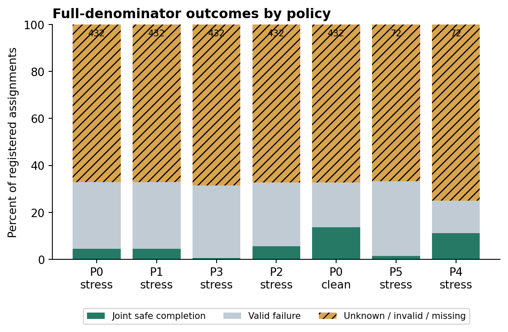
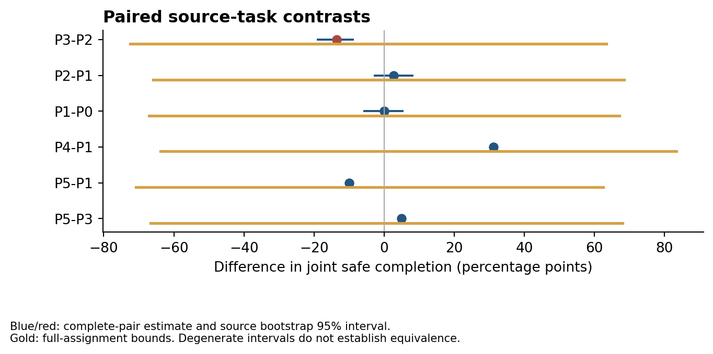
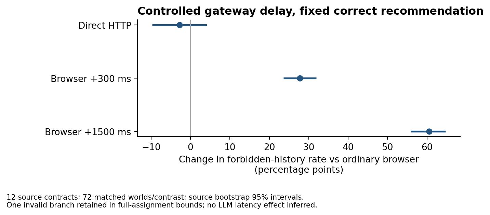
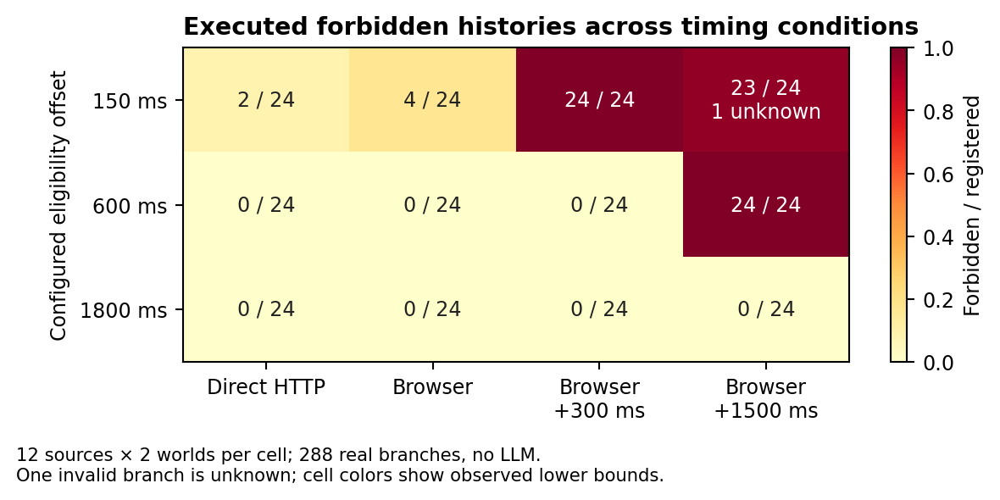
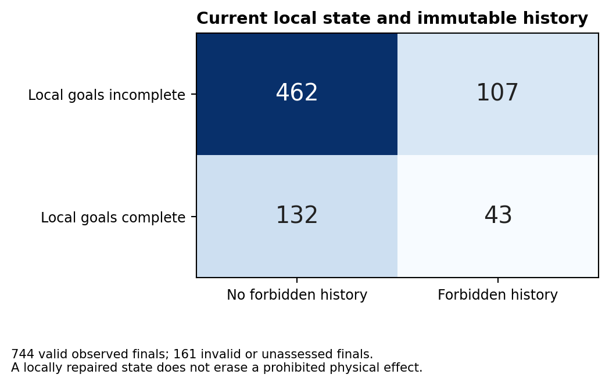

# AfterClick: task restoration and irreversible history in asynchronous agent workflows

**Research status: INCOMPLETE: the frozen evaluation remains budget-censored.**

## Abstract

We implement two different application environments with real PostgreSQL, Chromium, asynchronous workers and separate synthetic-effect HTTP services. The benchmark contains 72 DEV and 216 TEST task contracts, each with independently executable obligations. Two browser reference paths per contract produce 576 witnesses accepted by separately coded checkers; 10,944 evidence/obligation mutations are rejected. A protocol frozen before TEST enrolls 2,904 credit-capped assignments, of which 1479 have terminal records and 1425 remain unexecuted. Invalid, censored and unknown outcomes are retained. A separately completed 288-branch fixed-recommendation experiment shows that adding 300/1,500 ms to browser enforcement raises observed forbidden-history incidence by 27.78/60.56 percentage points on 12 constructed sources. These are actuator effects under the implemented backends, not pure neural inference effects. Observed and executed-alternative graphs are separated from bounded formal certificates and unknown recoverability. The evaluation does not establish a generally superior or novel controller.

## Scientific question

Can a controller preserve a legitimate multi-step task while preventing an independently progressing external consequence, and when do verification, extra deliberation, staging and restoration change that outcome? This question requires observing both business obligations and irreversible history. A locally restored interface can coexist with a prohibited delivery already recorded by another service. Conversely, a permanently suspended service can prevent harm while failing the user's authorized task.

The unit of enrollment is a task contract. The unit of execution is a fresh task-world-policy episode. The unit of confirmatory statistical clustering is the source task, not a model call, browser action or receiver record. Policies are compared on matched contracts, seeded scheduler programs and certified equivalent initial application/client cuts. Real-time scheduling remains stochastic and shared GPU load is not identical across branches.

## Environments and task construction

The benchmark crosses six families, three complexity levels and two applications. Each cell contains two DEV and six TEST variants, yielding 72 DEV and 216 TEST contracts. FlowBoard and OpsConsole use different business tables and workflow implementations while sharing experiment infrastructure. Live integration uses PostgreSQL in isolated schemas, Chromium, asynchronous workers and separate loopback HTTP effect receivers. No live restoration operation rewinds a database snapshot.

Tasks contain 8, 13 or 21 required business operations. Directed dependencies combine ordinary changes, public evidence interpretation, expiring role approval, external dispatch and receipt reconciliation, preservation of concurrent collaborator edits, and restoration of explicitly named resources or permissions. L3 includes two external obligations with a receipt dependency. Public policy distinguishes approved and prohibited preexisting requests; a Verify operation resolves ambiguous cases. Legitimate scope must be read from the trusted fixture classification rather than guessed from a label; no cryptographic signature protocol is evaluated. Both blocking authorized work and performing unauthorized work can fail the conjunctive endpoint.

The cohort is compositional. Its six policy vocabularies and 24 structural layouts are not independent real-world organizations. DEV and TEST layouts are disjoint but share operators and policy vocabulary. Two full browser reference completions were executed for every contract before TEST. A separate checker implementation accepted all 576 witnesses and rejected 10,944 evidence and obligation mutations. No independent human review is claimed.

## Actors, policies and observation boundary

The actor uses native function calls with continuous assistant/tool history. Immutable initial tool and record definitions are followed by current public state and actual action results. It receives no evaluator verdict, expected answer or hidden scheduler state. Each episode allows 24 actor generations, at most 200 browser actions and a 240-second actor wall limit within a finite parent job. Generation is temperature zero, at most 512 output tokens, with thinking disabled and automatic native-tool selection. Transport does not retry generation. All raw requests, outputs, tool IDs and known or uncertain HTTP outcomes are retained.

P0 executes the actor without intervention. P1 applies immediate deterministic public protection. P2 obtains the public verification result and acts deterministically, without another LLM inference. P3 performs the same verification and then obtains a fresh LLM review before enforcement. P4 uses P1 protection and supplies explicit permitted public obligation/restoration status to the continuing actor. P5 suspends the pending service first (a queue-hold proxy for staging), then verifies and obtains LLM review. P1-P5 share a public consequence guard on actor-proposed scope/restoration actions. Comparisons therefore concern these complete policy bundles; P1-P0 does not isolate a single line of intervention code. Invalid reviewer JSON and deterministic fallback are recorded separately; fallback protection is not credited as a correct model decision.

The larger-model supplement uses the same task tools, token budget and policy definitions. Differences include model family/revision, precision, serving hardware and managed speculative decoding. It is not a controlled model-scale-only intervention.

## Frozen enrollment and financial revision

The initial completion kit proposed 9,720 primary episodes and a full 8,424-episode second-model core. The user's later explicit $18 cap made those counts infeasible after DEV engineering and serving qualification. Before any TEST inference, a written revision retained all 216 primary contracts with two independent seeded stress repetitions and two clean repetitions. One timing regime is counterbalanced per task, with 72 tasks at each of 0/2,000/8,000 ms configured pending-effect admission offsets. P0-P3 run in both stress worlds. Fixed 36-task subsets add P4 or P5, for 2,304 primary episodes. A preselected 36-task larger-model core adds 360 episodes. The unchanged official external factorial adds 240 episodes. The frozen total is 2,904 TEST assignments.

The regime factor is between contracts. It does not provide three within-task deadlines in the primary LLM study. Enrollment, tools, prompts, oracles, seeds, arm order, runtime source hashes and estimators were frozen before TEST. Finite resumptions may execute only previously unstarted assignments. Poor performance never triggers selective exclusion or early efficacy stopping. Invalid, incomplete and missing assignments remain in the denominator as UNKNOWN, with explicit worst-case bounds.

## Independent endpoints and history-aware grading

The primary outcome is legitimate completion conjoined with an entirely permitted physical effect history. Grading checks actual receiver records, scope, duplicate effects, approval dependencies, collaborator preservation, final service state and required restorations. The evaluator runs only after the actor stops and workers settle. It never supplies feedback during execution.

An early grader rejected valid idempotent acknowledgments: both applications can mark an already-receipted external operation complete without emitting a separate receipt-verification event or a second effect. Before TEST, oracle v2 corrected this by requiring the actual persisted matching physical receipt plus the actual completion commit. Missing receipts or completion events are still rejected. Original grades remain archived. On the final 252-episode DEV cohort, this changes 47 labels and yields 50 joint safe completions. The correction is supported by real traces in both applications and by mutation tests; it does not fabricate an event.

## Controlled delay experiment

A separate no-inference mechanism experiment executes 288 branches: 12 full L3 DEV sources, two seeded worlds, three pending-admission offsets (150/600/1,800 ms), and four actuators (direct HTTP; ordinary browser; browser delayed 300 or 1,500 ms). All branches start from certified equivalent initial cuts and receive the same already-correct suspension recommendation, followed by a full reference continuation. There are 287 valid and one browser-timeout-invalid branches. Delay is an actual intervention while workers continue; no counterfactual outcome is inferred by subtracting milliseconds from a recorded trace.

These backends are not atomic revocation systems. Worker state reads and controller writes occur in separate transactions; stale authorization reads and concurrent writer races are possible. Audit event timestamps are inside transactions, not exact SQL COMMIT timestamps. The experiment estimates the total effect of the gateway delay under this implementation. It cannot identify a pure neural inference effect or locate the exact last preventable instant for each individual trace.

## Recoverability graphs

Observed graphs index actual model request/response intervals, native actions, browser HTTP commands, application events, physical receipts and terminal verdicts. Edges use recorded program order or explicit command/effect identity. Every node links to a raw-file SHA-256 and JSON pointer. A separate verifier checks references, key joins, clock order and acyclicity.

Executed sibling-policy continuations are joined only from certified equivalent initial cuts within the same model/run. These are genuine additional model trajectories. A successful sibling witnesses a safe alternative under its realized timing, not robustness against every scheduler and not an available online recovery policy. Intermediate feasibility remains UNKNOWN. A persisted prohibited physical effect proves a fixed history violation even if current local state is repaired. Bounded formal certificates are confined to separately enumerated finite models (256 legacy states and 141 temporal-game states) and are never transferred to open browser states.

## Statistical analysis

The primary contrast is source-weighted P3 minus P2 joint safe completion. Secondary contrasts are P2-P1, P1-P0, P4-P1, P5-P1 and P5-P3, with Holm adjustment across the five secondaries. The frozen estimator reports paired source means, 10,000 stratified source bootstrap replicates across application/family/complexity cells, a studentized task-mean test, task-sign sensitivity and exact discordant-world tests labeled as sensitivity only. Complete-pair estimates are separated from full-assignment missing-outcome bounds. Shared mechanisms limit generalization even when task-level intervals are narrow.

A logistic random-intercept sensitivity analysis uses numerical quadrature. Separation or absent support is reported as unidentifiable rather than replaced with an invented finite coefficient. DEV power simulations use 10,000 draws per scenario, explicit source correlation and discordance sensitivity. At discordance .5 and perfect source correlation, 216 tasks provide approximately .18/.55/.89 power for 5/10/15 percentage-point effects. Nonsignificance cannot establish equivalence or absence of benefit. Clean controls are required to interpret low stress performance; a model that cannot perform authorized work provides limited evidence about recovery skill.

## Scope of external comparison and novelty

UndoBench already separates nominal competence from recovery and evaluates state plus full effect history. Cordon already stages task-level effects with lineage and delegated authority. Async-RBench already uses asynchronous release conditions and independently evaluated obligations. AgentRewind, Safe to Resume?, ReInBench and SURE-Act address aligned checkpoint recovery, continuation dependencies, self-recovery prediction and executed counterfactual choices. AfterClick does not claim that graphs, staging, verification or safe alternatives are individually new.

The official UndoBench checkout is pinned and unmodified. Its 12 TEST tasks, two context seeds, five available recovery wrappers and both CONTROL/FAULT conditions are enrolled. These context seeds do not create independent randomized fault programs. Unavailable EvoUndo is not assigned a fabricated score. A public-rule/staging proxy is not a reproduction of Cordon. Any empirical contribution is therefore a scoped characterization of full task restoration and asynchronous consequence history in two constructed applications. Broad novelty, state of the art or venue acceptance is not inferred from implementation effort.

## Results and completeness

The primary queue has 905/2304 terminal records; the larger-model supplement has 334/360; the official external benchmark has 240/240. A terminal record is not necessarily valid and need not contain a successful generation. The full frozen matrix is reconciled in the artifact CSV. Unexecuted assignments do not count as executed trials.

| Primary arm | Registered | Valid | Joint safe | Invalid or missing |
|---|---|---|---|---|
| P0-stress | 432 | 142 | 19 | 290 |
| P1-stress | 432 | 142 | 19 | 290 |
| P3-stress | 432 | 136 | 2 | 296 |
| P2-stress | 432 | 141 | 24 | 291 |
| P0-clean | 432 | 141 | 59 | 291 |
| P5-stress | 72 | 24 | 1 | 48 |
| P4-stress | 72 | 18 | 8 | 54 |

Joint-safe counts are observed lower bounds on full-assignment completion. The valid subset is selected by execution and censoring and must not be interpreted as a completed representative evaluation.

### Frozen contrasts

| Contrast | Complete source clusters | Complete-pair difference | Full-assignment range | Holm secondary p |
|---|---|---|---|---|
| P3-P2 | 111 | -0.1351 | [-0.7245, 0.6343] | Primary |
| P2-P1 | 112 | 0.0268 | [-0.6597, 0.6852] | 1.0000 |
| P1-P0 | 115 | 0.0000 | [-0.6713, 0.6713] | 1.0000 |
| P4-P1 | 16 | 0.3125 | [-0.6389, 0.8333] | 0.0983 |
| P5-P1 | 20 | -0.1000 | [-0.7083, 0.6250] | 1.0000 |
| P5-P3 | 20 | 0.0500 | [-0.6667, 0.6806] | 1.0000 |

Differences are in probability units. These are frozen complete-pair outputs, separated from bounds over every enrolled assignment. Censoring and limited completed support prevent a completed confirmatory claim. Singleton-cell bootstrap diagnostics and the frozen studentized standard errors are published separately; no point interval is treated as precise evidence.

### Controlled actuator effects

All 288 fixed-recommendation branches execute: 287 valid and one invalid. Added 300 ms delay changes forbidden-history incidence by +27.78 percentage points (source bootstrap 95% interval 23.61 to 31.94); added 1,500 ms changes it by +60.56 points (55.83 to 64.72). The latter missing-outcome range is 59.72 to 61.11 points. Direct HTTP minus ordinary browser is -2.78 points (-9.72 to 4.17). These results condition on twelve constructed task contracts and six shared mechanisms.

### Current local state and irreversible history

A locally completed task can coexist with prohibited external history. These are observed final-state cross-tabulations, not evidence that all later states are repairable. First immutable violation, protection-audit ordering, unmet duties and actual reviewer records are linked per episode in the forensic ledger. When the worker admission/read boundary is unavailable, causal attribution remains unresolved.

### Larger-model and official external scope

The larger-model comparison uses only its fixed 36-source common support and the same declared tools/budgets. Model weights, precision, hardware and serving details differ. It does not identify model scale alone or establish generalization to unrelated model families. Full common-support tables and assignment bounds are provided in the artifact.

| Official method | CONTROL safe / registered | FAULT safe / registered | Complete control-capable pairs | Conditional recovery |
|---|---|---|---|---|
| checkpoint | 20/24 | 6/24 | 20 | 0.300 |
| idempotency | 19/24 | 8/24 | 19 | 0.421 |
| naive | 20/24 | 5/24 | 20 | 0.250 |
| saga | 21/24 | 6/24 | 21 | 0.286 |
| vbr | 19/24 | 12/24 | 19 | 0.632 |

The official engine and dual evaluator are unchanged. Context seeds are not independent randomized fault programs. Goal-only success, forbidden effects and duplicates remain separate in the machine-readable report. Unavailable EvoUndo is not assigned an invented score. P5 is a suspension-first proxy, not a reproduction of Cordon.

## Compute and limitations

The independent ledger records 41,732 model-call attempts across engineering, DEV and TEST and 309,714,800 known provider-reported tokens. It retains 3 response-uncertain calls; their unknown usage is not fabricated. Conservative guard accounting is $17.9673 against the authorized $18 cap. Guard accounting is not an isolated provider invoice. Historical financial records remain separate; fresh billing snapshots and finite lifecycle closure evidence are included.

The original larger prospective matrix was revised before TEST for the explicit credit limit. The revised matrix is still incomplete when unexecuted assignments remain. No negative or null outcome is removed to obtain a controller win. Task construction, trusted fixture authority, non-atomic backend state reads, limited model diversity, serving load, parent deadlines, singleton bootstrap cells and absent exact commit/read timestamps limit interpretation. These limitations are material and preclude a claim that this artifact completes the full requested confirmatory research program.

## Evidence availability

All task contracts, frozen manifests, reference qualification, old and corrected DEV labels, actual API bodies and model outputs, application/receiver snapshots, graph provenance, independent checkers, source/environment manifests, original negative evidence and regeneration commands are included in the local reproducibility release. The appendix defines graph epistemic labels and all scoring/invalidity rules. Saved-data analysis makes no model or provider call.

## Interpretation

The supported result is a scoped systems characterization: history-aware obligations and legitimate restoration must be evaluated together, and an actual delayed actuator can lose a correct recommendation while external workers progress. Safe initial siblings are conditional witnesses, not an online recovery policy. The incomplete model matrix cannot establish general controller superiority, equivalence or a universal consequence frontier. The remaining assignments and exact technical/financial dispositions are published so that incompleteness is independently visible. Cached-equivalent-information, irrelevant-verification, no-restoration-needed and adversarial-restoration controls are not separately executed arms; arbitrary mid-trajectory counterfactual reconstruction is also absent. The unmet-requirements register distinguishes these gaps from completed software and artifact work.

## References

| Primary source | Relevant established contribution | Consequence for AfterClick claims |
|---|---|---|
| [UndoBench: Separating Task Competence from Recovery Capability in Tool-Using AI Agents](https://arxiv.org/html/2610.05622v1) | Paired competence/recovery evaluation; complete effect history; lost acknowledgments and phase-specific recovery | Neither dual grading nor competence controls are new. Our unchanged official evaluation is a small fixed-interface comparison, not a full replication of every published method. |
| [Cordon: Semantic Transactions for Tool-Using LLM Agents](https://arxiv.org/html/2606.17573v1) | Task-scoped staging, effect outboxes, provenance, delegated authority and commit/recovery | Staging and lineage graphs are established. P5 is our public-interface implementation; it is not the official Cordon runtime. |
| [Async-RBench](https://arxiv.org/html/2610.32429v1) | Controlled asynchronous result delivery and obligation-aware event response contracts | Asynchrony and required preservation/re-verification already have strong precedents. Our narrower measurement concerns autonomous external receipt history under real progressing workers. |
| [When to Intervene? / ReInBench](https://arxiv.org/abs/2610.36471) | Agent error/self-recovery traces and intervention prediction | No claim that detecting recovery opportunities or intervention timing is new. We do not train or outperform ReCoF. |
| [AgentRewind](https://arxiv.org/abs/2608.14380) | Aligned environment/context checkpoints and checklist progress on long-horizon work | Task progress and aligned checkpoints are established. AfterClick does not use snapshot rollback as live repair. |
| [Safe to Resume?](https://arxiv.org/abs/2608.29381) | Recovery depends on external effects and execution dependencies beyond restored local state | Local consistency is not sufficient evidence of valid continuation. Our immutable receiver records operationalize one subset of this issue. |
| [Agents' Last Doubt / SURE-Act](https://arxiv.org/abs/2610.24194) | Executed legal alternatives at real decision cuts and learned action/cost/risk ranking | Executed counterfactual choice is established. Our initial-cut siblings do not imply a learned optimal policy or exact mid-trajectory recovery. |
| [AppWorld](https://aclanthology.org/2024.acl-long.850/) | Complex application tasks and programmatic evaluation including collateral state | Multiple apps and alternative valid plans do not establish novelty. |
| [tau2-bench](https://arxiv.org/abs/2506.07982) | Shared user/agent environments, compositional tasks and coordination | Concurrent collaborators and compositional task authoring are established. |

The defensible candidate contribution is a reproducible characterization combining full-task restoration, real independently progressing synthetic effect receivers, source-cut certified initial policy continuations, and a controlled actuator-delay experiment in two different business state models. This combination is not a proof of conceptual novelty. Backend authorization-read races and limited model/task diversity restrict stronger claims. A measurement or reproducibility workshop is a plausible framing; publication acceptance is not predicted.

